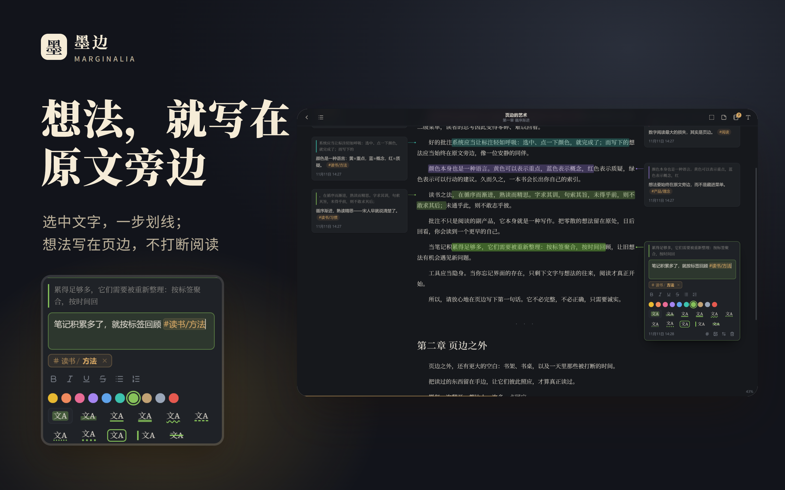
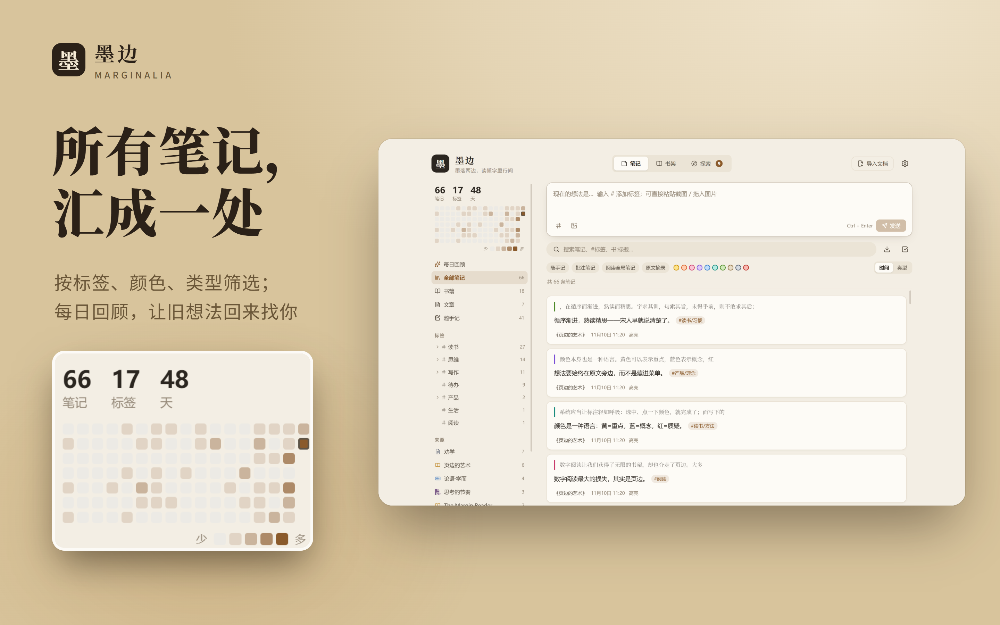
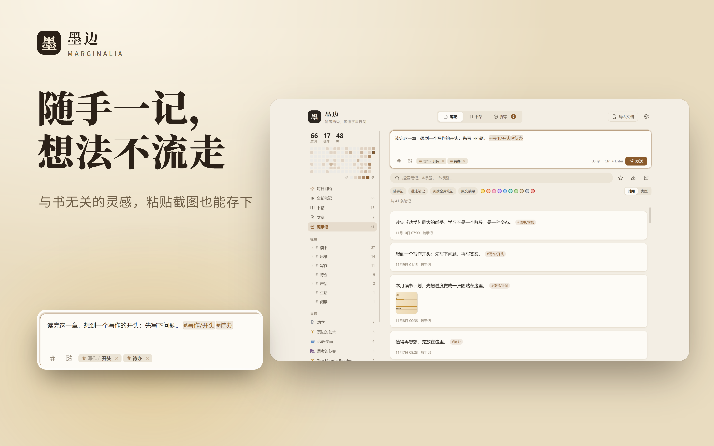
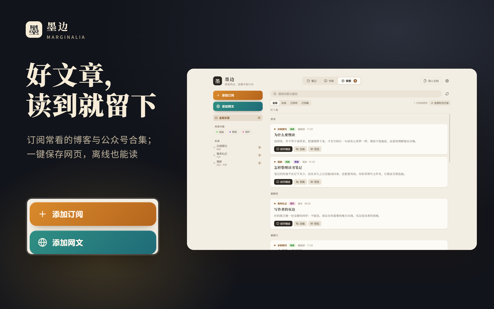
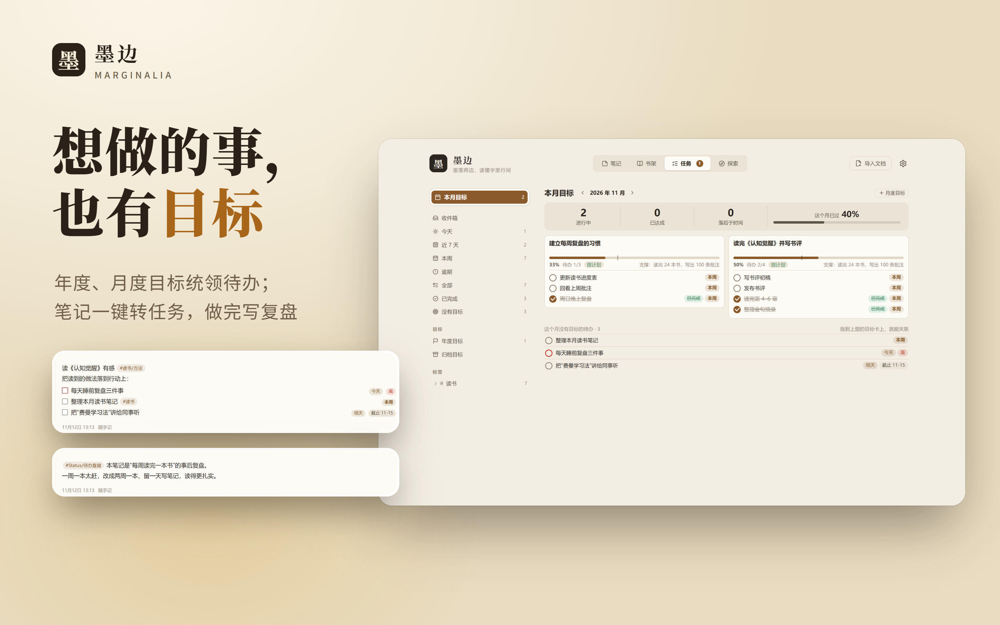
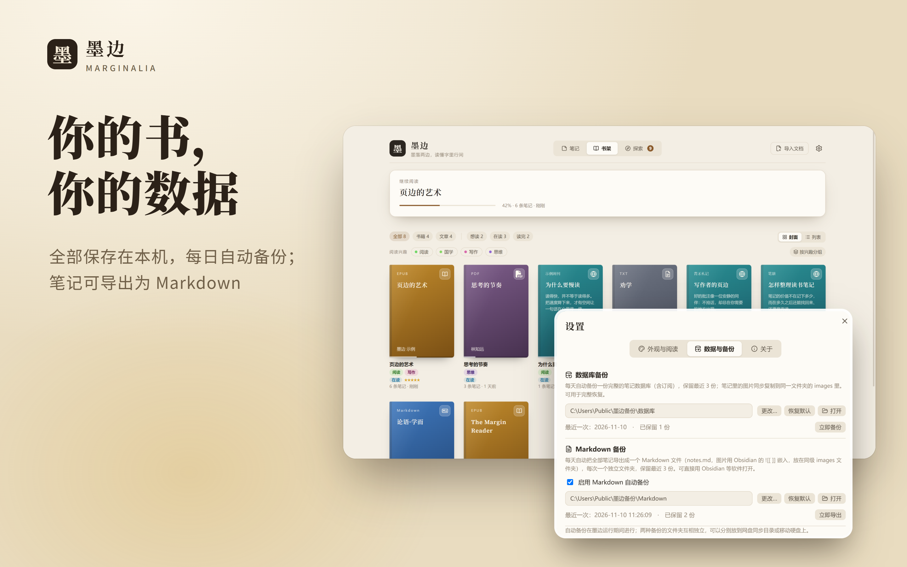
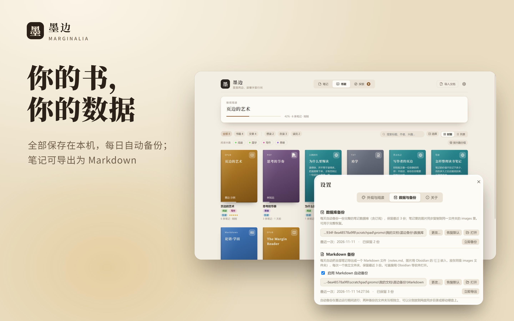

# 墨边 · Marginalia 使用指南

> **信息唾手可得的年代，稀缺的是专注，和真正读懂的能力。**
>
> 墨边陪你把好书读透、把想法留在原文旁边，再把收获落成目标和待办——**精读，是为了更好地用时间。**

---

## 一、它是什么

墨边是一个装在你电脑里的**阅读 + 笔记 + 待办**软件。

- 你把电子书、PDF、文章、网页放进来，在正文里划线、写想法；
- 想法落在页面两侧的空白处（页边），像在纸书上批注；
- 所有批注、随手记下的念头，自动汇到一个「笔记中心」，用标签整理；
- 笔记里的行动，可以变成待办和目标，推着你真的去做。

**所有内容都存在你自己的电脑上**，不需要注册账号，不联网也能用，也不会把你的笔记上传到任何地方。

目前提供 Windows 版。

---

## 二、它解决什么问题

| 你可能遇到的情况 | 墨边怎么帮你 |
|---|---|
| 读过的书、文章，过两个月什么都想不起来 | 划线和想法都留在原文旁边，点一下就回到那一页；每天自动抽几条旧笔记「回顾」 |
| 收藏夹、微信收藏、稍后读，收了从来不看 | 网页直接存成离线文章，和书放在同一个书架里，读完留下笔记 |
| 想法散在备忘录、聊天记录、纸条上 | 一个「随手记」输入框，写完按 Ctrl+Enter；用 `#标签` 归类 |
| 读书笔记和要做的事是两张皮 | 笔记里的一句话可以变成待办，待办挂到本月目标下 |
| 笔记越记越多，找不到 | 标签树、全文搜索、Ctrl+K 一键找任何东西，连书里的原文也能搜 |
| 担心软件有一天不能用，数据出不来 | 笔记可导出为普通 Markdown，数据库可定时备份 |

它**不是**什么：不是网盘，不是在线协作文档，不是 AI 助手。它是一个安静、属于你个人的阅读和思考工作台。

---

## 三、AI 时代，更要精读

现在想知道一件事，问 AI 几秒钟就有答案：总结一篇文章、概括一本书、列出要点。这很方便，但有一个要提防的地方：**如果什么信息都靠 AI 来读、来总结，自己就少了「读懂、想明白、记住」这个过程。** 长期下去，专注力、理解力和记忆力都可能退化。这个过程不能被代劳，因为它本身就是学习。

墨边不替你读书。它做的是相反的事：帮你把书**慢慢读完、读透**，并把读的收获留下来。

- **AI 摘要适合「决定要不要读」，不适合「代替读」。** 先用摘要判断一篇文章值不值得花时间；值得的，就自己从头读一遍。
- **重要的东西，自己动手划线、写想法。** 用自己的话写一句「这段话说了什么、我怎么看」，比读十遍摘要都管用。
- **别只收藏不读。** 存下来的网页和文章，设一个每周读完的目标；读不完的，宁可删掉。
- **用「笔记回顾」让知识留在脑子里，而不是留在手机里。** 每天回顾几条自己写的笔记，是在训练记忆。
- **先自己想，再去问。** 读到不懂的地方，先写下你的猜测和疑问，再去查资料或问 AI，最后把得到的答案**用自己的话**补进笔记。
- **把 AI 当作对话的对象，不当作答案的来源。** 它可能出错，也可能一本正经地说错；你读过原文、有自己的笔记，才有能力判断。

**对学生**：作业、论文和复习，最容易被「让 AI 总结一下」取代。短期省事，长期的代价是自己没有真正学会，考试和以后的工作都没有 AI 在旁边。建议：教材、论文自己读完并批注，AI 只用来检查自己的理解、解答卡住的问题，而不是直接要结论。

**对在家教育的家长**：您的学习和积累，是孩子最直接的榜样。孩子看到的是您怎么读书、怎么做笔记，而不是您转发了多少总结。建议：每天留出固定时间，和孩子各读各的书，各记各的笔记；再一起聊聊。教材和读物自己先读一遍，笔记里写下您自己的理解，再决定怎么教。AI 可以帮您备课找资料，但不要用它替代您对内容本身的理解。

---

## 四、五分钟上手

1. **放进第一本书**：把 EPUB、PDF、TXT、Markdown 文件拖进窗口；或在书架点「保存网页」，粘贴一个网址（也可以直接在书架上 Ctrl+V）。
2. **打开阅读**：双击书。选中一段文字，会出现工具条，选颜色和样式（高亮、下划线、波浪线……）。
3. **写想法**：选中文字后点「笔记」，想法会出现在页面边上。可以写 `#读书/方法` 这样的标签。
4. **写随手记**：回到首页「笔记」，顶部有个写作框，想到什么写什么。
5. **找东西**：按 **Ctrl+K**，输入任何词，笔记、书、命令、设置都能搜到。

> 小提示：Ctrl+N 新建笔记，Ctrl+Shift+N 新建待办，在任何页面都能用。

---

## 五、主要功能一览

**阅读**
- 支持 EPUB、PDF、Markdown、TXT、网页文章。
- 纸张 / 素白 / 夜读三种外观，字体、字号可调，自动记住读到哪里。
- 扫描版 PDF（只有图片）可以直接用鼠标框选一块区域做批注。
- 在一本书里搜文字，所有匹配处会同时用红框标出，右侧给出目录式的列表，点哪个跳哪个。

**笔记**
- 划线 + 想法，和原文位置绑定，改字号也不会错位。
- 多级标签，例如 `#工作/项目A/复盘`；点父标签会包含所有子标签。
- 笔记之间可以连线并写一句说明（支持、反驳、举例、延伸……），有一张「关系图」可以看全貌。
- 笔记中支持粗体、斜体、列表，也可以贴图（截图直接 Ctrl+V）。
- **笔记回顾**：每天从旧笔记里挑几条给你看，按遗忘规律安排，帮助真正记住。
- **标签主题页**：点一个标签，看到围绕这个主题的所有笔记、相关标签和时间分布。

**待办与目标**
- 待办、本月目标、年度目标；目标按进度显示百分比，落后于时间会变红。
- 笔记里的一行字可以一键变成待办。

**订阅**
- 把你常看的博客、网站、公众号合集加进来，新文章汇成一个收件箱，喜欢的一键存成离线文章。

**整理与安心**
- **回收站**：删除的笔记和待办保留 30 天，可以恢复。
- **备份**：数据库可定时备份；笔记可导出为 Markdown，用 Obsidian 等软件也能打开。
- **桌面小卡片**：把「每日回顾」和「今日待办」放在桌面上，点一下回到软件对应位置。

---

## 六、不同的人怎么用

### 大学生

**典型场景**：教材、论文 PDF、课程讲义、考研资料，期末前要把所有东西串起来。

- **一门课一个标签**：`#高数`、`#经济学原理/供给需求`……批注时顺手打上，期末点开标签主题页，整门课的重点就按主题汇齐了。
- **论文用「整体笔记」**：每篇论文读完写一条整体笔记——研究问题、方法、结论、对我有什么用；再用「关系」把相互引用、相互反驳的论文连起来，写综述时打开关系图就是提纲。
- **用颜色分层**：比如黄色表示「考点」，蓝色表示「不懂」，红色表示「易错」。之后用组合搜索 `色:红 #高数` 一次看完易错点。
- **扫描版教材**：直接框选批注，不需要文字层。
- **复习**：打开「笔记回顾」，每天十分钟，把旧笔记过一遍，比考前突击轻松。
- **自己读，自己写**：教材和论文自己读完、自己批注，笔记用自己的话写。AI 可以帮你检查理解、解答卡住的问题，但别让它替你读和总结（见第三节）。
- **目标**：本月目标写「读完《某书》」「完成实验报告」，待办里拆成每天要做的几步。

### 普通职场人士

**典型场景**：行业文章、公司文档、会议想法、学习计划，时间碎，容易遗忘。

- **碎片时间只做两件事**：看到好文章，粘贴网址存起来；有想法，按 Ctrl+N 写下来。其余的以后再整理。
- **按工作线打标签**：`#工作/项目A`、`#工作/客户B`、`#成长/管理`。周五花十分钟看标签主题页，就是一份现成的周总结素材。
- **把想法变成行动**：读到有启发的做法，选中它，转成待办，放进本月目标。让阅读落到工作里。
- **订阅行业信息源**：把几个常看的博客和公众号合集加进「探索」，集中在一个收件箱看，不被各个平台的推荐流带跑。
- **桌面卡片**：开机后一眼看到今天的待办和一条旧笔记。
- **提醒**：软件不会联网上传内容，但如果你要处理公司机密资料，仍建议遵守所在公司对资料存放的规定，不要把受限文件放进任何个人软件里。

### 自由职业者（写作、设计、咨询、翻译等）

**典型场景**：同时做几个项目，素材很多，需要把积累变成作品和报价。

- **一个客户或项目一个标签**：把相关的参考资料、网页、PDF 放进书架，批注直接记在原文旁，之后回头不用重新翻找。
- **素材库**：灵感、金句、案例，用随手记 + 标签积累；做新项目时按标签检索，就是你自己的素材库。
- **笔记关系图**：把案例之间、观点之间的关系连起来，做方案、写文章时很快理出结构。
- **导出为 Markdown**：写文章、整理交付物时，把某个标签下的笔记导出，直接拿去用。
- **目标管理**：「本月目标」写收入或交付节点，「待办」拆到每天，落后会变红提醒你。
- **备份**：你的积累就是你的资产，建议开启定时备份，并把备份目录放在另一块盘或网盘同步文件夹以外你信任的地方。

### 在家教育孩子的父母

**典型场景**：自己选教材、选读物，要观察孩子的进展，也要安排每天的学习。

- **给每个孩子或每个科目一个标签**：`#小明/语文`、`#小明/科学`。陪读时随手记下孩子问的好问题、读不懂的地方、有趣的反应。
- **记录学习轨迹**：每周看一次标签主题页，能看到这个孩子这段时间读了什么、问了什么，作为调整计划的依据。
- **整理教材和读物**：电子绘本、PDF 教材、文章放进书架，按「阅读兴趣」分类；孩子读过的会有进度。
- **划线做亲子共读**：把好句子、新词划出来，读完一起回顾；「笔记回顾」每天抽几条旧笔记，做成睡前的小问答。
- **您自己也在学**：留出固定时间，和孩子各读各的书、各记各的笔记；教材先自己读一遍，笔记写下自己的理解，再决定怎么教。AI 适合备课查资料，不宜代替您对内容的理解（见第三节）。
- **每周计划**：本月目标写「完成这本书」「做三个实验」，待办里排每天要做的事。
- **注意**：这是一个给大人用的工具，界面不是儿童版；孩子的名字和学习情况只存在你自己的电脑里。

### 研究者与长期写作者（补充）

- 用「笔记关系」建立论证网络，用标签按议题归类，用 Ctrl+K 找书中原文，导出 Markdown 到写作软件。

---

## 七、让它越用越顺手的小习惯

1. **先记下来，再整理**。不要因为想不好标签而不记。
2. **标签宁少勿多**。一级标签控制在十个以内，细分用子标签。
3. **每周看一次标签主题页**，十分钟，让笔记真正流动起来。
4. **每天打开一次「笔记回顾」**，哪怕只看三条。
5. **每月备份一次，或开启自动备份**。

---

## 八、快捷键速查

| 快捷键 | 作用 |
|---|---|
| Ctrl+K | 搜索一切 / 执行命令 |
| Ctrl+N | 新建笔记 |
| Ctrl+Shift+N | 新建待办 |
| Ctrl+Enter | 发送随手记 |
| Ctrl+B / I / U | 粗体 / 斜体 / 下划线 |
| Ctrl + 加号 / 减号 | 调整字号 |
| Shift + 右键 | 显示系统菜单 |

更多快捷键可在「设置 → 快捷键」里查看和修改。

---

## 九、常见问题

**我的数据存在哪里？**
都在你自己的电脑上。新安装的数据在 `%APPDATA%\Marginalia`。你可以在「设置 → 数据与备份」里设置备份位置，并立即备份一次。

**换电脑怎么办？**
把备份文件复制到新电脑，或把数据目录整体复制过去。目前还不能在多台设备间自动同步（云同步功能正在开发中）。

**需要联网吗？**
不需要。只有「保存网页」和「订阅」会访问你指定的网站，用来读取内容，不会上传你的任何笔记。

**删错了怎么办？**
在回收站里找，保留 30 天。

**打不开某些 PDF / EPUB？**
请把文件发给开发者，帮助改进。设置里「关于」有联系方式。

---

*祝阅读愉快，笔记常新。*
