# 墨边 · Marginalia 使用指南

> **信息唾手可得的年代，稀缺的是专注，和真正读懂的能力。**
>
> 墨边陪你把好书读透、把想法留在原文旁边，再把收获落成目标和待办——**精读，是为了更好地用时间。**

> 本指南里的截图使用的都是虚构的示例材料。另有一份 31 页的介绍 PPT（PDF）：[docs/marginalia-intro.pdf](docs/marginalia-intro.pdf)。

---

## 目录

1. [它是什么](#一它是什么)
2. [它解决什么问题](#二它解决什么问题)
3. [AI 时代，更要精读](#三ai-时代更要精读)
4. [设计理念](#四设计理念)
5. [五分钟上手](#五五分钟上手)
6. [主要功能](#六主要功能)
7. [不同的人怎么用](#七不同的人怎么用)
8. [一个人的一周](#八一个人的一周)
9. [让它越用越顺手的小习惯](#九让它越用越顺手的小习惯)
10. [快捷键速查](#十快捷键速查)
11. [常见问题](#十一常见问题)

---

## 一、它是什么

墨边是一个装在你电脑里的**阅读 + 笔记 + 待办**软件。

- 你把电子书、PDF、文章、网页放进来，在正文里划线、写想法；
- 想法落在页面两侧的空白处（页边），像在纸书上批注；
- 所有批注、随手记下的念头，自动汇到一个「笔记中心」，用标签整理；
- 笔记之间可以连线，写明它们为什么相关；
- 笔记里的行动，可以变成待办和目标，推着你真的去做；
- 每天回顾几条旧笔记，每周盘点一次。

**所有内容都存在你自己的电脑上**，不需要注册账号，不联网也能用，也不会把你的笔记上传到任何地方。

目前提供 Windows 版（安装包见 [Releases](https://github.com/jiandanchaofan/marginalia/releases)）。

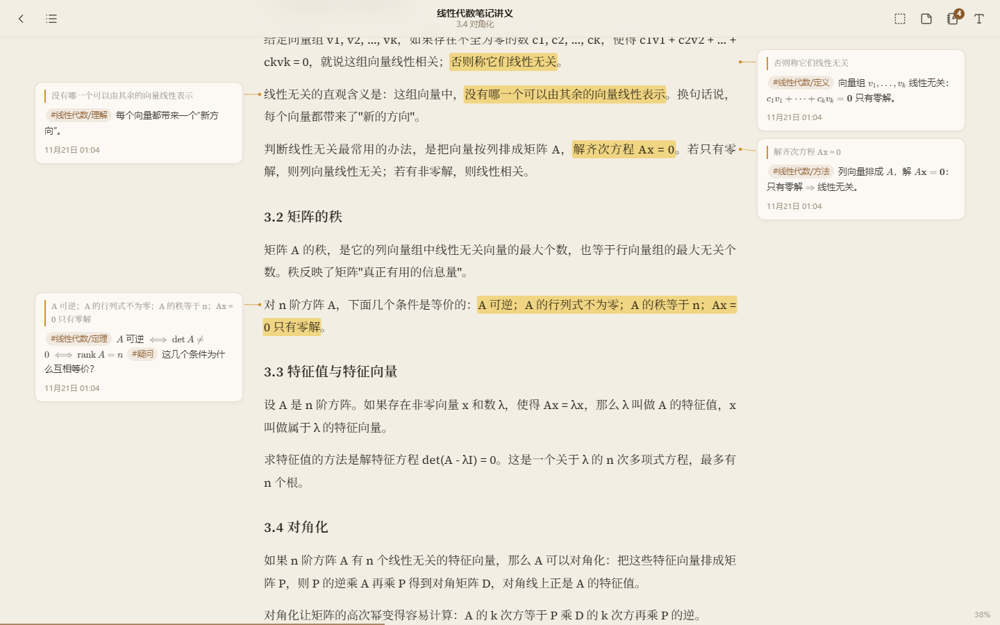

*阅读界面：正文被划线，两侧是对应的笔记卡片。*

---

## 二、它解决什么问题

| 你可能遇到的情况 | 墨边怎么帮你 |
|---|---|
| 读过的书、文章，过两个月什么都想不起来 | 划线和想法都留在原文旁边，点一下就回到那一页；每天自动抽几条旧笔记「回顾」 |
| 收藏夹、微信收藏、稍后读，收了从来不看 | 网页直接存成离线文章，和书放在同一个书架里，读完留下笔记 |
| 想法散在备忘录、聊天记录、纸条上 | 一个「随手记」输入框，写完按 Ctrl+Enter；用 `#标签` 归类 |
| 读书笔记和要做的事是两张皮 | 笔记里的一句话可以变成待办，待办挂到本月目标下 |
| 笔记越记越多，找不到 | 标签树、全文搜索、Ctrl+K 一键找任何东西，连书里的原文也能搜 |
| 担心软件有一天不能用，数据出不来 | 笔记可导出为普通 Markdown，数据库可定时备份，删除的内容保留 30 天 |

**现有工具各管一段**：阅读器能读、能划线，但划线留在书里，没有标签、没有关系，也变不成待办；笔记软件能记能整理，但和原文脱节，回头不知道这句话出自哪一页；待办软件能排日程，却和你正在读的内容没有联系。墨边的做法，是让读、记、想、做发生在同一个地方，并且彼此相连。

它**不是**什么：不是网盘，不是在线协作文档，不是 AI 助手。它是一个安静、属于你个人的阅读和思考工作台。

---

## 三、AI 时代，更要精读

现在想知道一件事，问 AI 几秒钟就有答案：总结一篇文章、概括一本书、列出要点。这很方便，但有一个要提防的地方：**如果什么信息都靠 AI 来读、来总结，自己就少了「读懂、想明白、记住」这个过程。** 长期下去，专注力、理解力和记忆力都可能退化。这个过程不能被代劳，因为它本身就是学习。

墨边不替你读书。它做的是相反的事：帮你把书**慢慢读完、读透**，并把读的收获留下来。

- **AI 摘要适合「决定要不要读」，不适合「代替读」。** 先用摘要判断一篇文章值不值得花时间；值得的，就自己从头读一遍。
- **重要的东西，自己动手划线、写想法。** 用自己的话写一句「这段话说了什么、我怎么看」，比读十遍摘要都管用。
- **别只收藏不读。** 存下来的网页和文章，设一个每周读完的目标；读不完的，宁可删掉。
- **用「笔记回顾」让知识留在脑子里，而不是留在手机里。** 每天回顾几条自己写的笔记，是在训练记忆。
- **先自己想，再去问。** 读到不懂的地方，先写下你的猜测和疑问，再去查资料或问 AI，最后把得到的答案**用自己的话**补进笔记。
- **把 AI 当作对话的对象，不当作答案的来源。** 它可能出错，也可能一本正经地说错；你读过原文、有自己的笔记，才有能力判断。

**对学生**：作业、论文和复习，最容易被「让 AI 总结一下」取代。短期省事，长期的代价是自己没有真正学会，考试和以后的工作都没有 AI 在旁边。建议：教材、论文自己读完并批注，AI 只用来检查自己的理解、解答卡住的问题，而不是直接要结论。

**对在家教育的家长**：您的学习和积累，是孩子最直接的榜样。孩子看到的是您怎么读书、怎么做笔记，而不是您转发了多少总结。建议：每天留出固定时间，和孩子各读各的书，各记各的笔记；再一起聊聊。教材和读物自己先读一遍，笔记里写下您自己的理解，再决定怎么教。AI 可以帮您备课找资料，但不要用它替代您对内容本身的理解。

---

## 四、设计理念

### 一条链路：读 → 记 → 想 → 做 → 回顾 → 输出

| 环节 | 墨边里怎么做 |
|---|---|
| 读 | EPUB、PDF、Markdown、TXT、网页文章，自动记住读到哪里 |
| 记 | 划线、框选区域、整体笔记、随手记；LaTeX 公式也能写 |
| 想 | 多级标签归类；笔记之间连线，写明是支持、反驳还是举例 |
| 做 | 笔记里的一句话一键变待办，挂到月度目标；四象限排优先级 |
| 回顾 | 按遗忘规律每天重读几条旧笔记；每周盘点读了什么、做了什么 |
| 输出 | 按标签或筛选结果导出 Markdown，在 Obsidian 等软件里直接打开 |

### 四个原则

1. **笔记连着原文。** 每条笔记同时记下它在原文中的位置和前后文，改字号、缩放窗口都不会错位，点一下就回到那一页、那一行。
2. **想法之间可以连线。** 关系是多对多的网：一条笔记可以连任意多条，同一对笔记之间还能有多条关系，每条写一句说明。
3. **旧笔记会回来找你。** 按遗忘规律安排间隔，从 1 天到 240 天。读完选「忘了 / 模糊 / 记得」，系统决定下次什么时候再见。
4. **数据留在自己手里。** 不注册账号，不联网也能用。笔记存在本机，可导出为普通 Markdown，数据库可定时备份。

### 笔记为什么不会丢、不会错位

- **双重定位**：像同时用「第几个字」和「这句话的原文及前后文」两种方式做标记，字号改了、排版变了，也能找回原位。
- **区域批注按比例保存**：扫描版 PDF 没有文字，框选的区域按页面比例记录，缩放窗口时始终贴住原位置；框住的内容还会截成图片放进笔记。
- **记得读到哪里**：自动记住阅读位置，与字号无关。

### 核心做稳，专业内容做成插件

多数人都会用的（阅读、笔记、待办、回顾、公式）是核心；少数人才需要的（词典、圣经研究、云同步）做成插件，在「设置 → 插件」里开关，不用时不占用你的界面。

---

## 五、五分钟上手

1. **放进第一本书**：把 EPUB、PDF、TXT、Markdown 文件拖进窗口；或在书架点「保存网页」，粘贴一个网址（也可以直接在书架上 Ctrl+V）。
2. **打开阅读**：双击书。选中一段文字，会出现工具条，选颜色和样式（高亮、下划线、波浪线……）。
3. **写想法**：选中文字后点「笔记」，想法会出现在页面边上。可以写 `#读书/方法` 这样的标签。
4. **写随手记**：回到首页「笔记」，顶部有个写作框，想到什么写什么。
5. **找东西**：按 **Ctrl+K**，输入任何词，笔记、书、命令、设置都能搜到。

> 小提示：Ctrl+N 新建笔记，Ctrl+T 新建待办，在任何页面都能用。

---

## 六、主要功能

### 读：一个安静的阅读器

- 支持 EPUB、PDF、Markdown、TXT（自动识别 GBK，按「第X章」切章）、网页文章。
- 纸张 / 素白 / 夜读三种外观，宋体、楷体、黑体，字号行距可调，自动记住读到哪里。
- 扫描版 PDF（只有图片）可以直接用鼠标框选一块区域做批注。
- 在一本书里搜文字，所有匹配处会同时用红框标出，右侧给出目录式的列表，点哪个跳哪个。
- 读书时自动记录真正在读的时间（窗口在前、有操作才计时，设置里可调整或关闭），书架顶部有阅读热力图。

### 记：划线、想法、整体笔记

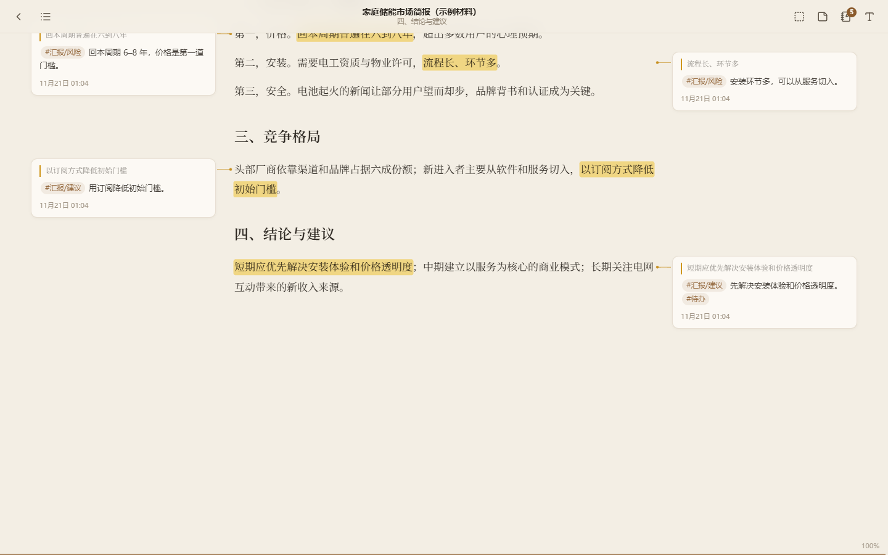

*选中文字，选颜色和样式，再写一句自己的话。*

- **标注**：10 种配色 × 12 种样式，高亮、下划线、波浪线、框选、圈注、删除线……
- **页边**：宽窗口双侧，较窄单侧，窄屏收起成色条；卡片对齐原文所在行。
- **整体笔记**：每本书、每篇文章还能写多条整体笔记，打 1–5 星，标记想读、在读、读完。
- **配图**：截图 Ctrl+V 直接贴进笔记，每条最多 9 张。
- 笔记中支持粗体、斜体、下划线、删除线、列表。

### 记：公式，LaTeX 书写，实时预览

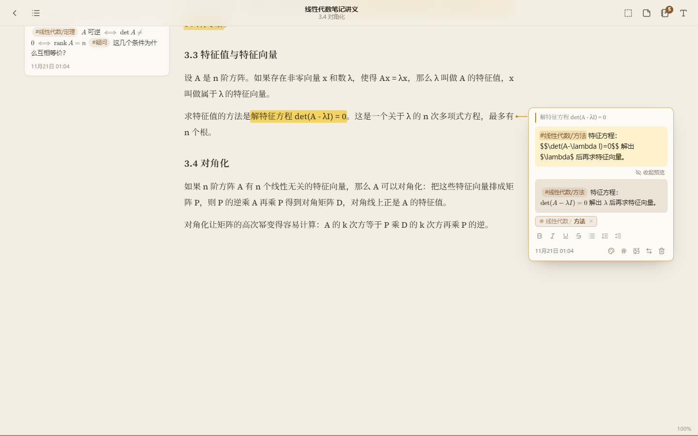

*精读理工科教材时，笔记里终于能写公式了。*

- **写法**：行内公式写 `$x^2+y^2$`；独立公式写 `$$a^2+b^2=c^2$$`，支持矩阵、方程组等常用写法，用 KaTeX 离线渲染。
- **预览**：编辑框右下角的「预览」显示整条笔记保存后的样子（格式、列表、待办、标签、公式）。默认收起；笔记里有公式时自动展开，手动收起后在这个编辑框里保持收起。
- **容错**：写错的公式用红色源码提示，不影响其余内容。
- **到处可见**：笔记卡片、回顾页、桌面卡片、每周回顾里都渲染成公式。图谱节点、搜索结果这类单行摘要仍显示源码。
- **不挑食**：公式以原文保存，搜索、Markdown 导出和备份不受影响。公式里不要写 `#`（会被当作标签）。

### 想：把笔记整理成体系

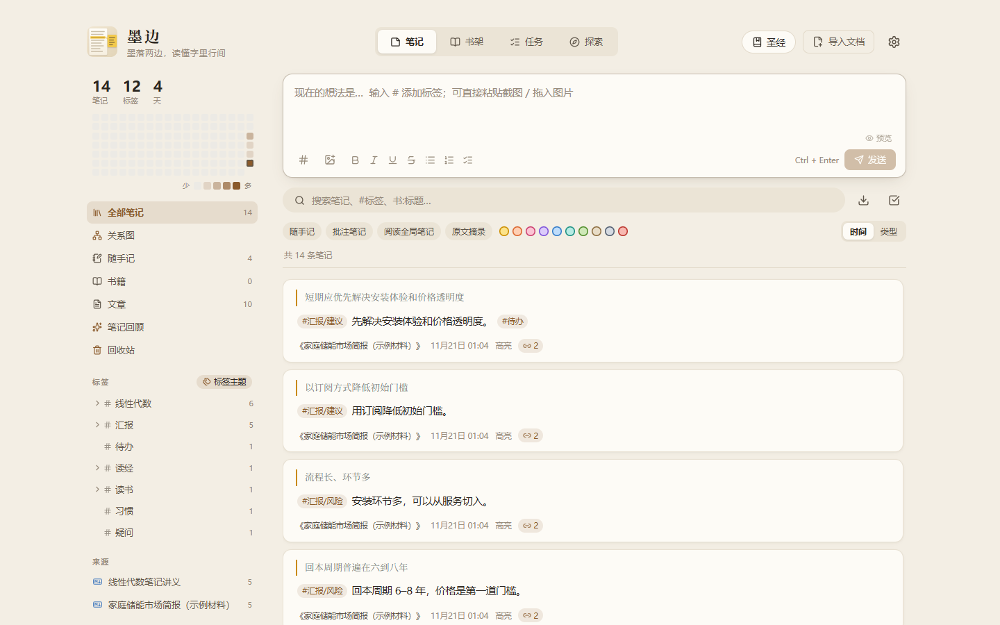

*所有批注和随手记，汇到同一个笔记中心。*

- **多级标签**：`#工作/项目A/复盘`；点父标签包含所有子标签，可置顶、改名、移动、合并。
- **标签主题页**：点一个标签，看到围绕这个主题的所有笔记、相关标签和时间分布；侧栏「标签主题」是总览，每个顶级标签一张卡片。
- **组合搜索**：`#标签` · `书:标题` · `色:琥珀` · `样式:波浪线` · `有想法`，可与关键词任意组合。
- **收藏的筛选**：把常用条件存起来，一键恢复。
- **随手记**：顶部写作框，Ctrl+Enter 发送，草稿自动保存；左上的热力图一天一个方块。
- **批量与导出**：批量加标签、改颜色、导出 Markdown。

### 想：让想法互相连线

*示例：汇报材料里的五条笔记，如何指向同一个结论。*

- **多对多**：一条笔记可连任意多条；同一对笔记之间可以有多条不同的关系。
- **怎么连**：笔记卡片上点「连接笔记」，或在关系图里把一张卡片拖到另一张上松手，填写关系（支持、反驳、举例、延伸……）。
- **看得清**：4 种连线样式、11 种颜色，实线、虚线、点线；「整理」按尽量少交叉重排。
- **看局部**：按标签筛选，或只看某条笔记的 1–3 度邻居；按 F 全屏。

### 做：待办、目标和四象限

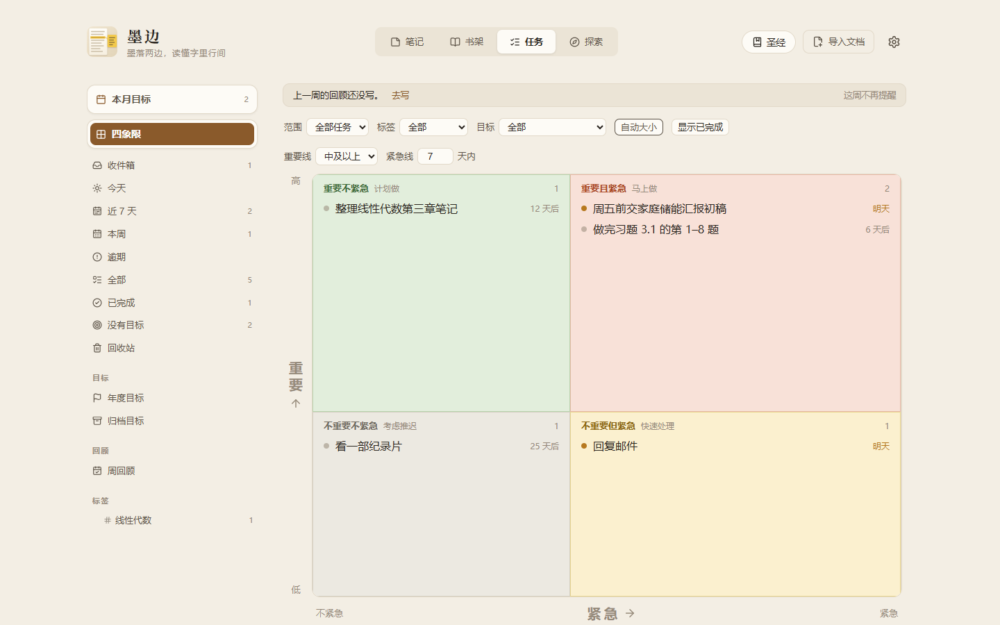

*四象限：按「重要线」和「紧急线」（都可调整）自动分格，把任务拖进「紧急」格，会自动排到近几天。*

*目标：任务挂到月度目标上，进度自动计算，落后于时间会变红。*

- 待办、本月目标、年度目标；笔记里的一行字可以一键变成待办。
- 任务页侧栏有「今天」「近 7 天」「本周」「逾期」「全部」等清单。

### 回顾：旧笔记会回来找你

*笔记回顾：读完选「忘了 / 模糊 / 记得」，系统安排下次什么时候再见。*

- **每天几条**：3、5、10、20 或不限，默认 5；新的一天从凌晨 4 点算起。
- **间隔**：约 1、3、7、14、30、60、120、240 天；记得升一级，模糊原地，忘了退两级。
- **别处也能看到**：桌面小卡片，以及每周回顾里的「回顾了 N 条，记得 X%」。

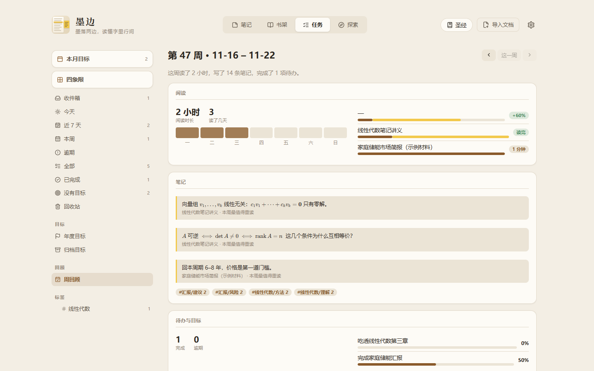

*每周回顾：先看数据，再回答三个问题，最后落到下周要做的事。*

- **自动汇总**：这周读了多久，写了哪些笔记（挑最值得重读的），完成了多少待办，目标进度如何。
- **三个问题**：学到并想保持什么？有什么遗憾和问题？对下周有什么想法？回答存成一条带标签的随手记。
- 「下周先做哪一件」直接成为下周的待办。

### 订阅与保存网页：不被推荐流带跑

- **订阅**：输入网站或博客地址，自动发现 RSS、Atom、JSON Feed；也支持公众号「合集」链接、批量粘贴和导入 OPML。新文章汇成一个收件箱，每 30 分钟自动更新；喜欢的一键存成离线文章。
- **保存网页**：书架上点「保存网页」，或直接 Ctrl+V 网址。提取正文，图片内嵌成离线快照；适配微信公众号；同一网址自动去重。
- **阅读兴趣**：给书和订阅来源标注「阅读兴趣」（如 AI、法律、历史），在侧栏按兴趣筛选；订阅保存的文章自动继承来源的兴趣。
- 笔记页和收件箱左侧的「来源」默认显示 15 个，其余在「更多来源」里展开。
- 订阅和保存网页只会访问你指定的网站，不会上传你的笔记。

### 整理与安心

- **回收站**：删除的笔记和待办保留 30 天，可以恢复。
- **备份**：数据库可定时备份，也可以立即备份一次；笔记可导出为 Markdown，用 Obsidian 等软件也能打开。
- **桌面小卡片**：把「每日回顾」和「今日待办」放在桌面上，点一下回到软件对应位置。
- **三种界面语言**：简体中文、繁体中文、English，默认跟随系统。
- **主题**：纸张、素白、夜读，以及柔绿、羊皮纸、棕色夜间。

### 插件：按需开启（设置 → 插件）

**词典**：加载你自己的 MDict 词典，选词即查，支持词形还原（running 会查到 run），一键把单词和简短释义摘录到笔记（默认标签「词汇」）。词典需要你自己准备。

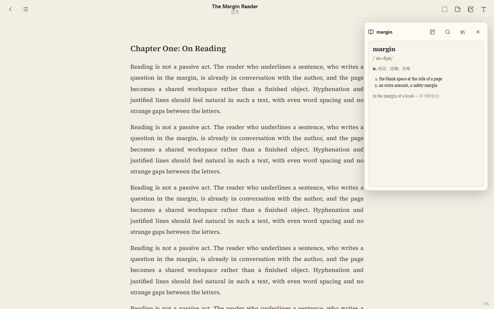

*图中词条是示例，不是真实词典内容。*

**圣经研究**：按卷阅读（66 卷，内置和合本简体与 World English Bible），保持印刷版的分段和诗歌分行，节号用小数字标注，可在节号气泡、行间、并排三种对照方式之间切换；整节笔记各译本通用；笔记里写「约 3:16」，鼠标悬停即显示经文预览；Ctrl+K 输入经文引用可直接跳转；读经计划（如「一年读完圣经」）每天生成一条待办。ESV 等有版权的译本不内置。该插件默认隐藏，在设置的插件区域连续点击 5 次显示。

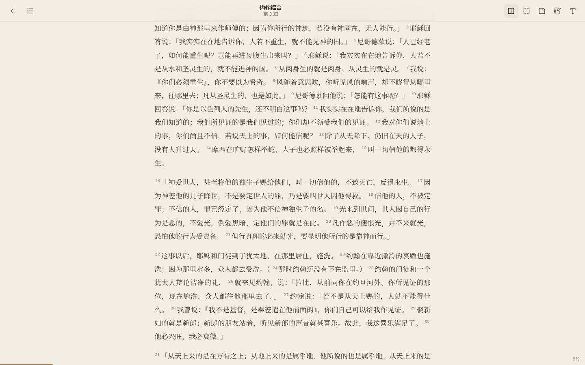

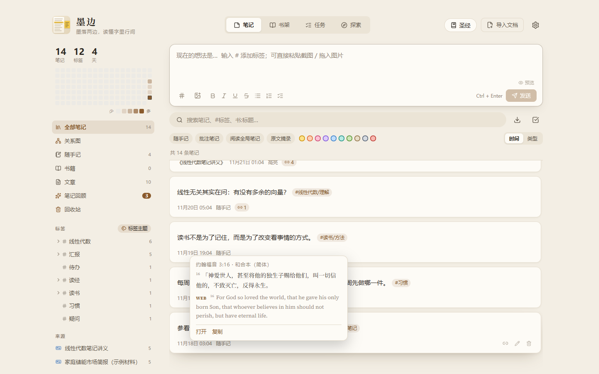

*悬停预览：和合本与 WEB 对照。*

**云同步**：开发中，默认关闭。现在换电脑请用备份。

---

## 七、不同的人怎么用

### 大学生与考生：精读线性代数教材

**典型场景**：教材、论文 PDF、课程讲义、考研资料，期末前要把所有东西串起来。定义、定理、例题混在一起，读完不知道重点；公式没处记。

| | |
|---|---|
| 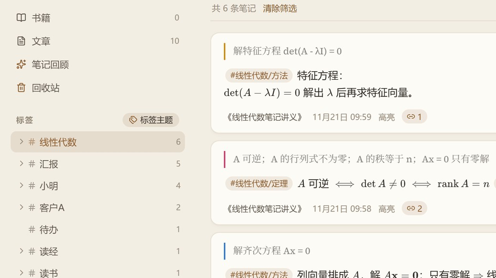 **一门课一个标签**：`#线性代数/定义`、`/定理`，点一下标签，这门课的笔记就汇齐了。 | 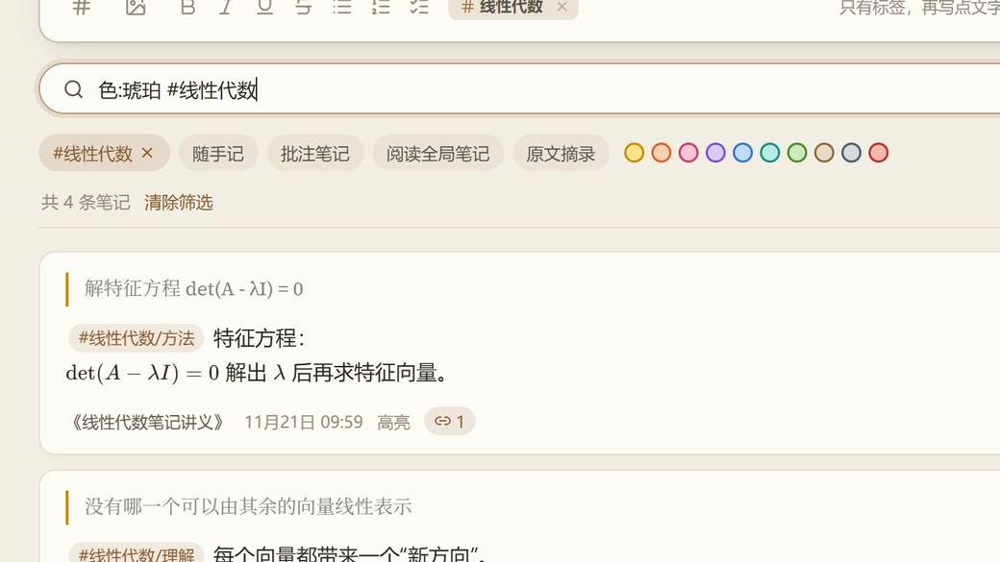 **颜色分层、组合搜索**：琥珀标考点，天青标不懂，玫瑰标易错；搜「色:琥珀 #线性代数」。 |
| 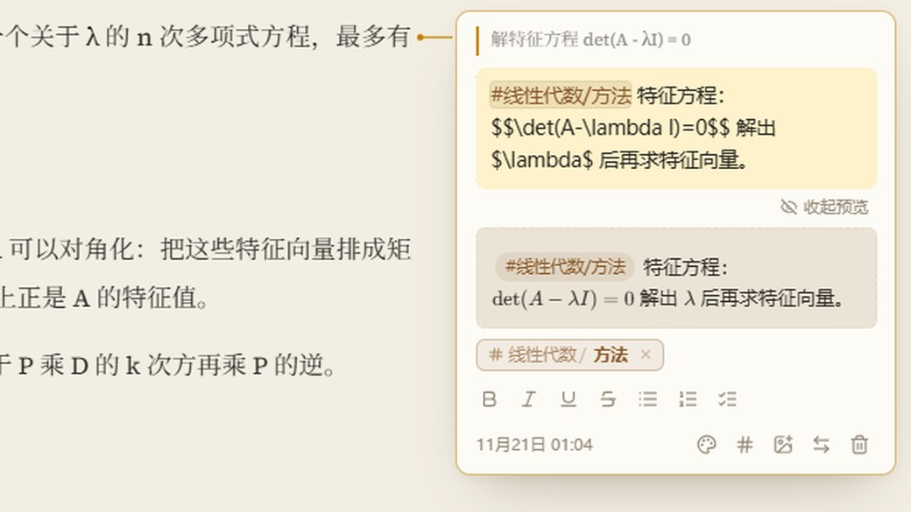 **公式照写**：用 LaTeX 写推导，下方实时预览；扫描版教材就框选公式，保存成截图笔记。 |  **每天十分钟回顾**：读完选「忘了 / 模糊 / 记得」，比考前突击轻松。 |

- **论文用「整体笔记」**：每篇论文读完写一条整体笔记——研究问题、方法、结论、对我有什么用；再用「关系」把相互引用、相互反驳的论文连起来，写综述时打开关系图就是提纲。
- **目标**：本月目标写「读完《某书》」「完成实验报告」，待办里拆成每天要做的几步。
- **自己读，自己写**：教材和论文自己读完、自己批注，笔记用自己的话写。AI 可以帮你检查理解、解答卡住的问题，但别让它替你读和总结（见第三节）。

### 职场人士：精读材料，整理成汇报

**典型场景**：行业文章、公司文档、会议想法、学习计划，时间碎，容易遗忘。几十页的材料读完只剩模糊印象，写汇报时又得从头翻。

| | |
|---|---|
|  **边读边划线**：结论、风险、建议分别打 `#汇报/` 下的标签，笔记贴在原文旁。 | 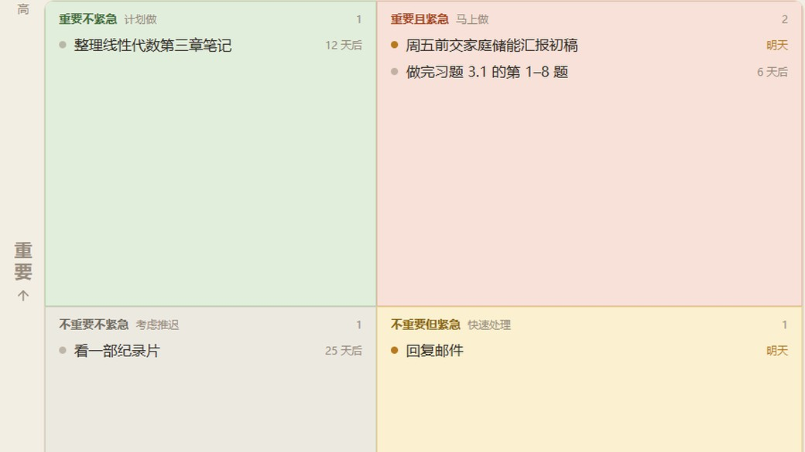 **四象限排优先级**：待办按重要、紧急分格，周五前要交的排在最显眼处。 |
| 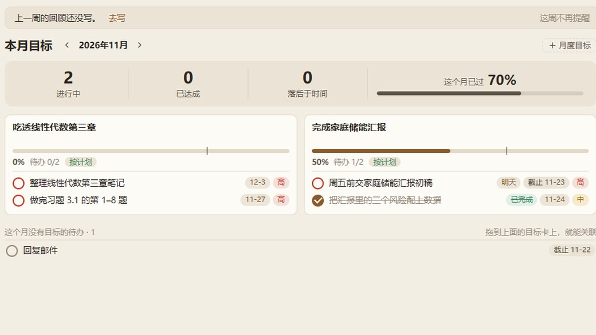 **目标挂待办**：笔记转成待办，挂到「完成家庭储能汇报」，进度自动计算。 | 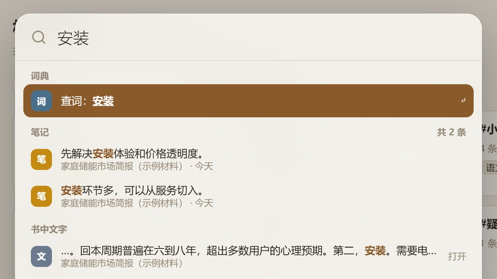 **Ctrl+K 找回**：搜「安装」，相关的笔记和书里的原文一起出来。 |

- **碎片时间只做两件事**：看到好文章，粘贴网址存起来；有想法，按 Ctrl+N 写下来。其余的以后再整理。
- **周五十分钟**：看标签主题页，就是一份现成的周总结素材。
- **订阅行业信息源**：把几个常看的博客和公众号合集加进「探索」，集中在一个收件箱看，不被各个平台的推荐流带跑。
- **提醒**：软件不会联网上传内容，但如果你要处理公司机密资料，仍建议遵守所在公司对资料存放的规定，不要把受限文件放进任何个人软件里。

### 自由职业者（写作、设计、咨询、翻译等）：把积累变成作品和报价

**典型场景**：同时做几个项目，素材很多，需要把积累变成作品和报价。

| | |
|---|---|
| 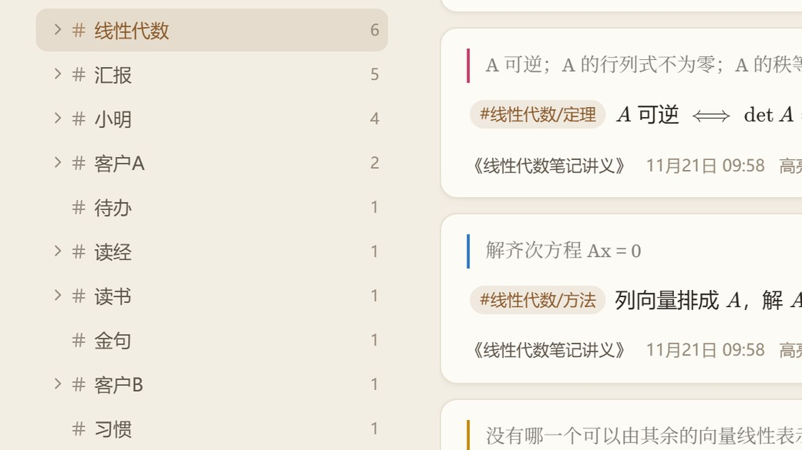 **一个项目一个标签**：`#客户A`、`#客户B`，参考资料批注在原文旁。 | 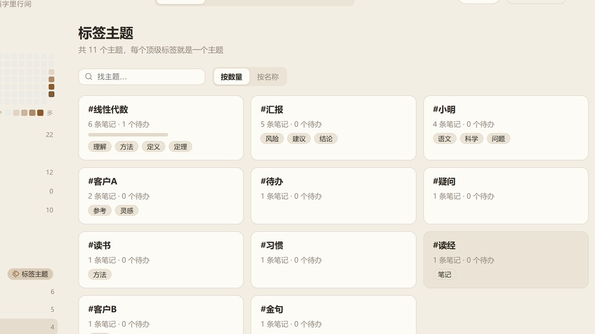 **标签主题页**：每个顶级标签是一个主题，参考、灵感、报价各自成组。 |
| 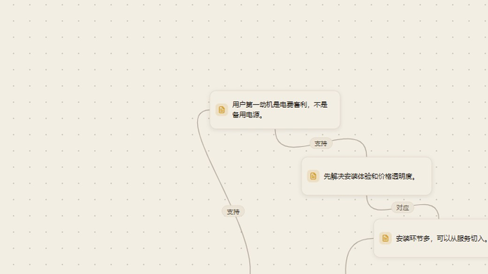 **关系图**：把案例和观点连起来，做方案时很快理出结构。 |  **每周回顾**：盘点读了什么、做成了什么；「下周先做哪一件」直接成为待办。 |

- **素材库**：灵感、金句、案例，用随手记 + 标签积累；做新项目时按标签检索，就是你自己的素材库。
- **导出为 Markdown**：写文章、整理交付物时，把某个标签下的笔记导出，直接拿去用。
- **目标管理**：「本月目标」写收入或交付节点，「待办」拆到每天，落后会变红提醒你。
- **备份**：你的积累就是你的资产，建议开启定时备份，并把备份目录放在你信任的地方。

### 研究者与长期写作者：建立论证网络

**典型场景**：论文和资料越读越多，论点之间的关系只存在脑子里。

| | |
|---|---|
| 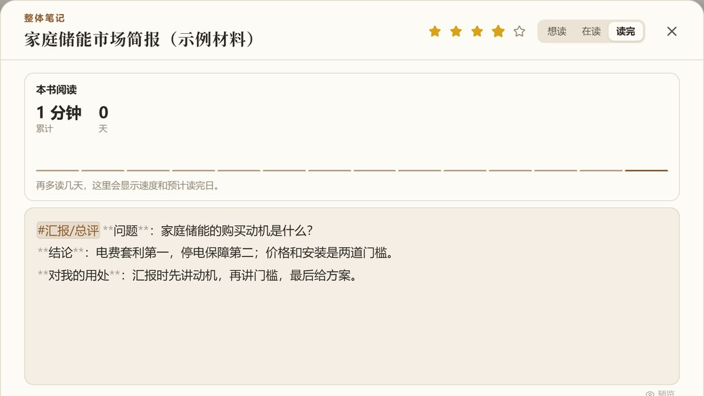 **整体笔记**：每篇读完写一条：问题、结论、对我的用处，还能打星、标记读完。 | 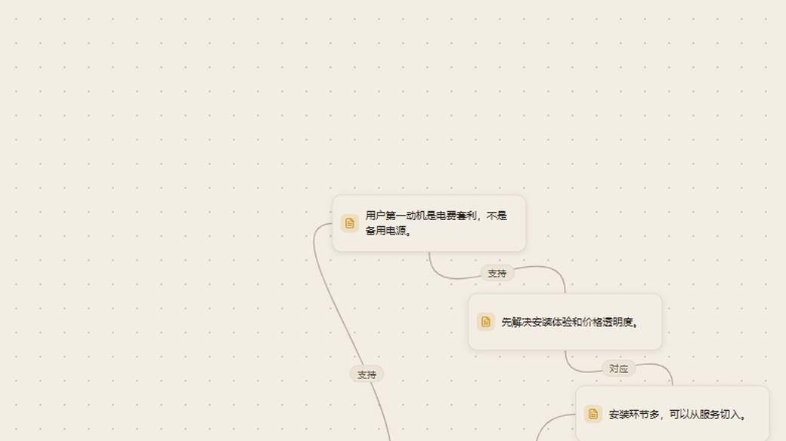 **连线**：连起相互引用、相互反驳的论文，写综述前先看关系图。 |
|  **组合搜索**：按议题打标签，再用标签、颜色、关键词组合筛选。 |  **按议题汇齐**：点一个标签，看到这个议题下的全部笔记，可导出 Markdown 当提纲。 |

- 关系图可以全屏，也可以只看某条笔记的 1–3 度邻居，在大图里聚焦。
- 用 Ctrl+K 找书中原文，导出 Markdown 到写作软件，笔记直接变成提纲。

### 在家教育孩子的父母：陪读、观察、安排计划

**典型场景**：自己选教材、选读物，要观察孩子的进展，也要安排每天的学习。

| | |
|---|---|
| 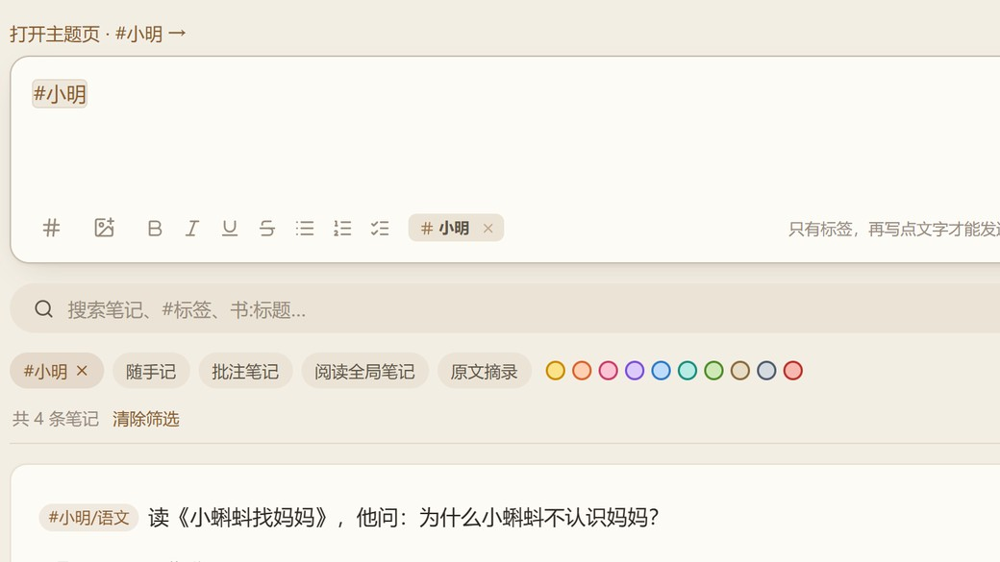 **随手记**：陪读时想到什么写什么，`#小明/语文`，按 Ctrl+Enter 发送。 |  **一个孩子一个标签**：点 `#小明`，看到他的问题、新词和小实验。 |
| 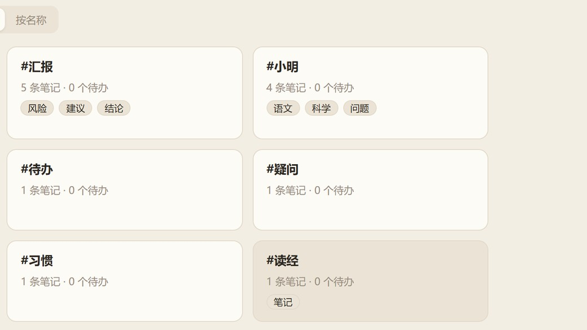 **每周看一次主题页**：了解这段时间读了什么、问了什么。 | 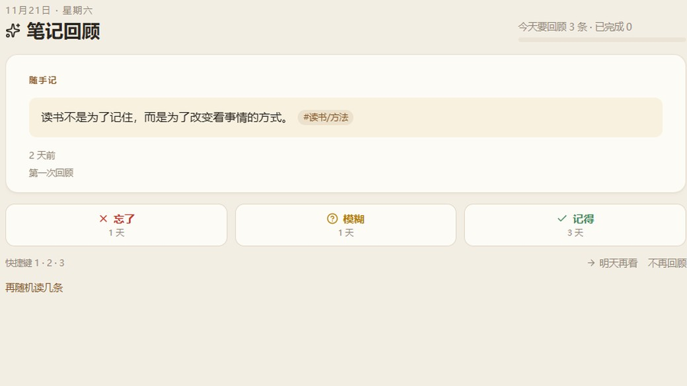 **睡前小问答**：笔记回顾每天抽几条，读完选「忘了 / 模糊 / 记得」。 |

- **整理教材和读物**：电子绘本、PDF 教材、文章放进书架，按「阅读兴趣」分类；孩子读过的会有进度。
- **划线做亲子共读**：把好句子、新词划出来，读完一起回顾。
- **您自己也在学**：留出固定时间，和孩子各读各的书、各记各的笔记；教材先自己读一遍，笔记写下自己的理解，再决定怎么教。AI 适合备课查资料，不宜代替您对内容的理解（见第三节）。
- **每周计划**：本月目标写「完成这本书」「做三个实验」，待办里排每天要做的事。
- **注意**：这是一个给大人用的工具，界面不是儿童版；孩子的名字和学习情况只存在你自己的电脑里。

### 读经与人文阅读者：按卷读经，笔记记在经文上

**典型场景**：对照译本、记笔记、跟读经计划，要在好几个软件间切换。需要先在「设置 → 插件」里开启圣经研究（见第六节）。

| | |
|---|---|
|  **按卷阅读**：66 卷分旧约、新约，内置和合本（简体）与 World English Bible。 |  **印刷版式**：保持分段和诗歌分行，节号以小数字标注，可切换三种对照方式。 |
|  **引用悬浮预览**：笔记里写「约 3:16」，悬停就显示和合本与 WEB 对照。 | 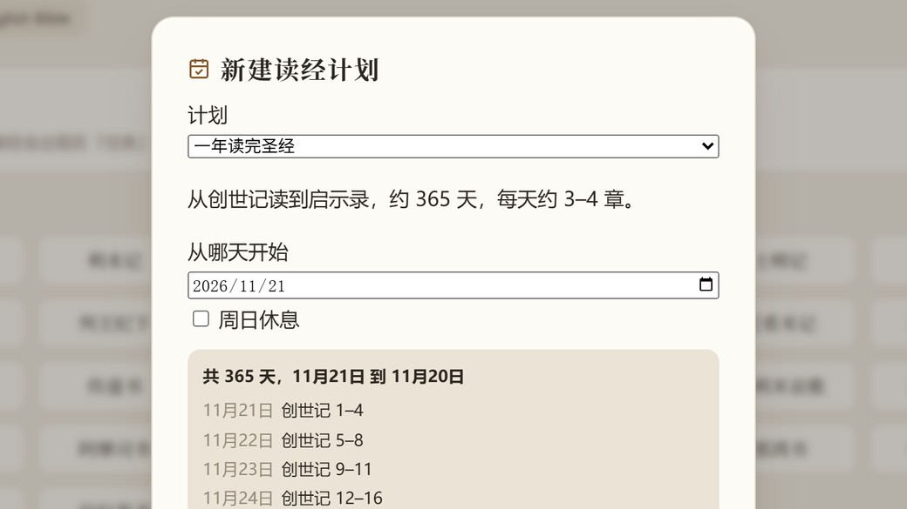 **读经计划**：如「一年读完圣经」，每天一条待办，没读的留在「逾期」里。 |

### 语言学习者与终身学习者：读英文原文，不离开页面

**典型场景**：读到生词要切到词典，回来又找不到读到哪了。需要先在「设置 → 插件」里加载你自己的 MDict 词典。

| | |
|---|---|
| 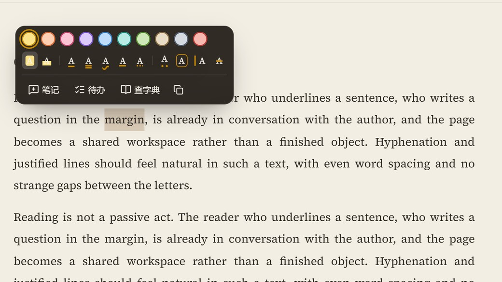 **选词**：在英文原文里选中单词，工具条上点「查字典」。 |  **词典卡片**：释义显示在页边，不离开正文；点左上角图标可摘录到笔记。 |
| 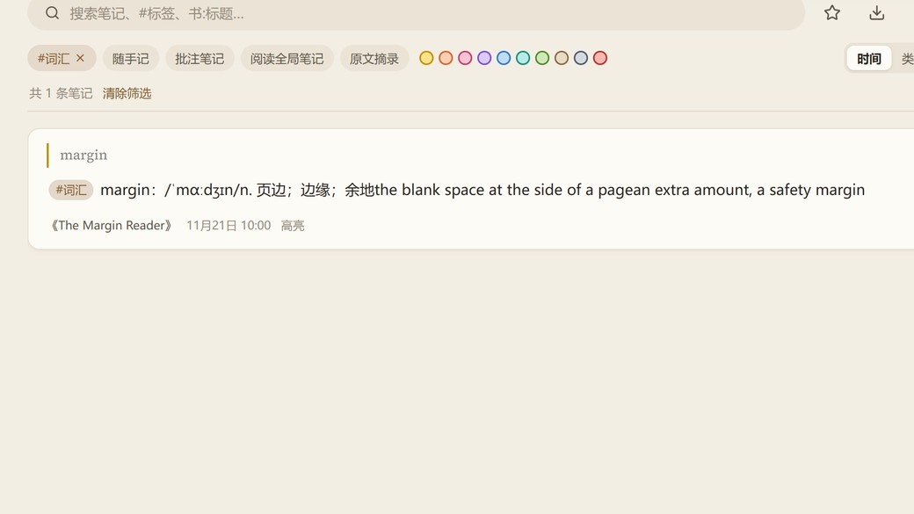 **词汇笔记**：摘录的词带标签 `#词汇`，连同出处书名，集中在一处。 |  **回顾**：存下的词会出现在每日笔记回顾里，隔几天再见一次。 |

想持续学习，还可以用收件箱订阅网站、保存网页，读完再决定记什么。图中词条是示例，不是真实词典内容。

---

## 八、一个人的一周

这是一个设想中的用法，不是真实用户的记录：

| 日子 | 做什么 | 用到 |
|---|---|---|
| 周一 | 订阅里看到一篇长文，保存成离线文章，放进书架 | 订阅、保存网页 |
| 周二 | 导入材料精读：划线、写想法、打标签 | 阅读、笔记 |
| 周三 | 给相关笔记连线，在关系图里整理论点 | 关系图 |
| 周四 | 把要做的事转成待办，挂到本月目标 | 待办、目标 |
| 周五 | 在四象限里拖一拖，决定先做哪件；看标签主题页 | 四象限、主题页 |
| 周六 | 每天十分钟，旧笔记回来见面 | 笔记回顾 |
| 周日 | 写每周回顾，「下周先做哪一件」直接成为待办 | 每周回顾 |

---

## 九、让它越用越顺手的小习惯

1. **先记下来，再整理**。不要因为想不好标签而不记。整理可以放到周五的十分钟里。
2. **标签宁少勿多**。一级标签控制在十个以内，细分用子标签。
3. **每周看一次标签主题页**，十分钟，让笔记真正流动起来。
4. **每天打开一次「笔记回顾」**，哪怕只看三条。
5. **每月备份一次，或开启自动备份**。

---

## 十、快捷键速查

| 快捷键 | 作用 |
|---|---|
| Ctrl+K | 搜索一切 / 执行命令 |
| Ctrl+N | 新建笔记 |
| Ctrl+T | 新建待办 |
| Ctrl+Enter | 发送随手记 / 保存笔记 |
| Ctrl+B / I / U | 粗体 / 斜体 / 下划线 |
| Ctrl + 加号 / 减号 | 调整字号 |
| Shift + 右键 | 显示系统菜单 |

更多快捷键可在「设置 → 快捷键」里查看和修改。Ctrl+K 里还有前缀：`#` 只搜标签，`@` 只搜书和文章，`/` 只搜命令，`~` 只搜书中文字。

---

## 十一、常见问题

**我的数据存在哪里？**
都在你自己的电脑上。新安装的数据在 `%APPDATA%\Marginalia`。你可以在「设置 → 数据与备份」里设置备份位置，并立即备份一次。

**换电脑怎么办？**
把备份文件复制到新电脑，或把数据目录整体复制过去。目前还不能在多台设备间自动同步（云同步功能正在开发中）。

**需要联网吗？**
不需要。只有「保存网页」和「订阅」会访问你指定的网站，用来读取内容，不会上传你的任何笔记。

**删错了怎么办？**
在回收站里找，保留 30 天，笔记和待办都可以恢复。

**升级到 0.7 之前要注意什么？**
0.7 的数据库已升级，升级后旧版（0.5.0）无法再打开这份数据。升级前请先备份。

**公式里能写 `#` 吗？**
不要写。笔记里的 `#` 会被当作标签。

**打不开某些 PDF / EPUB？**
请把文件发给开发者，帮助改进。设置里「关于」有联系方式。

---

*祝阅读愉快，笔记常新。*
