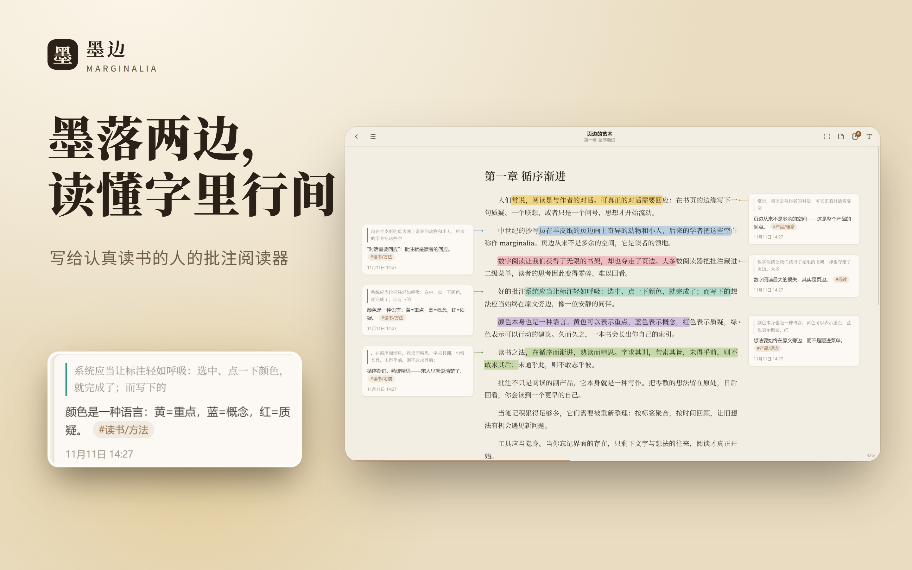
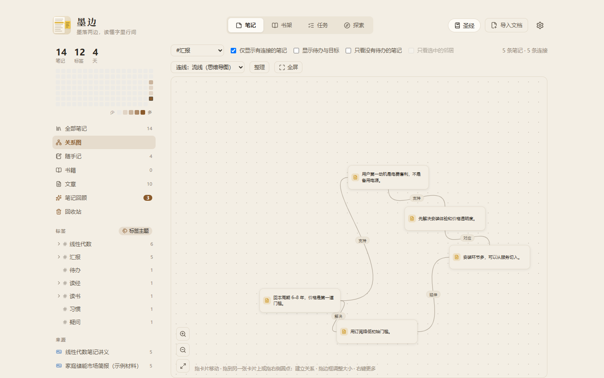
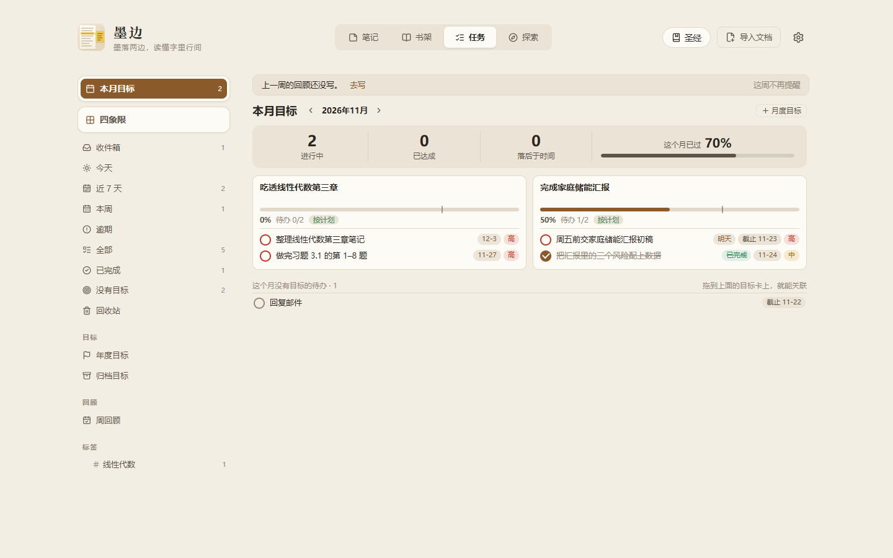
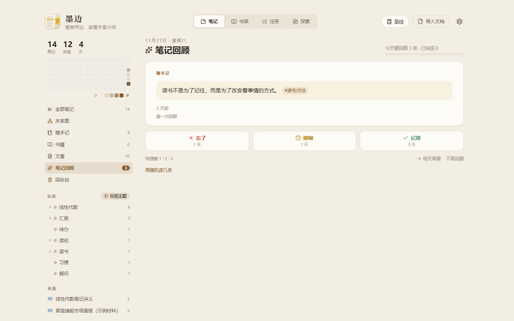
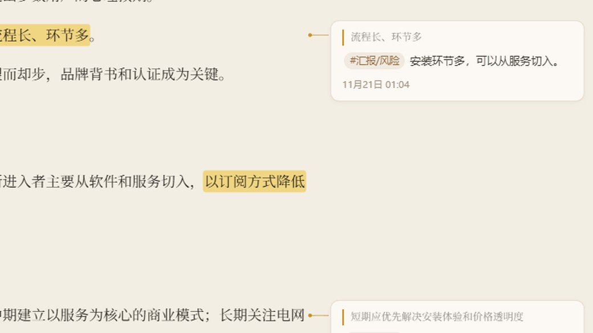
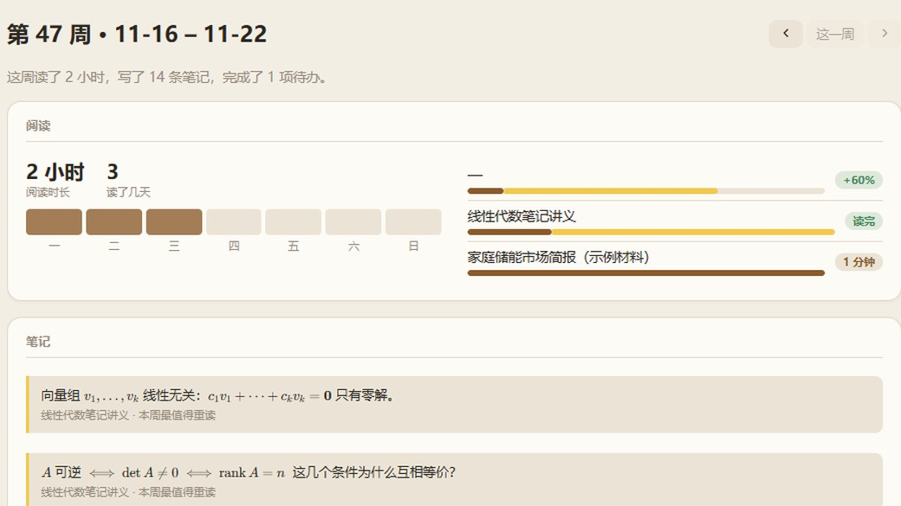
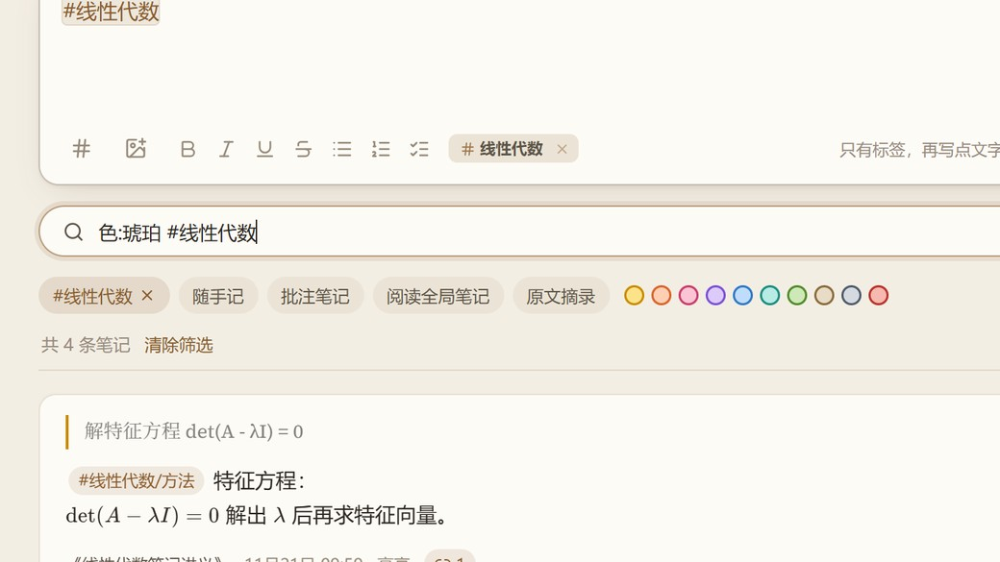
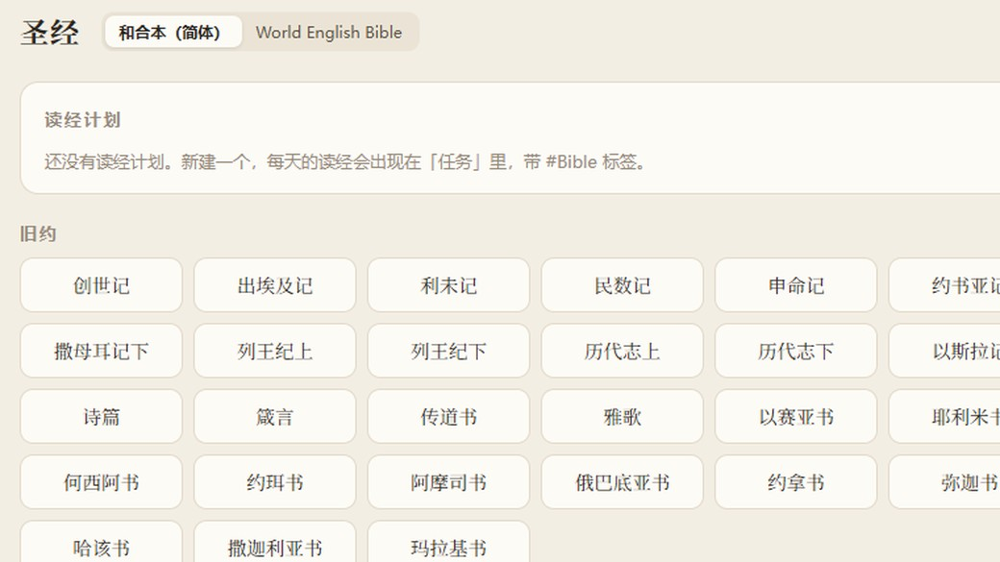
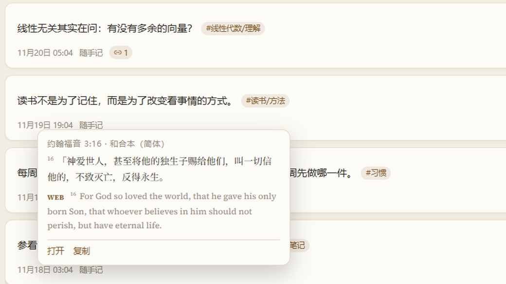
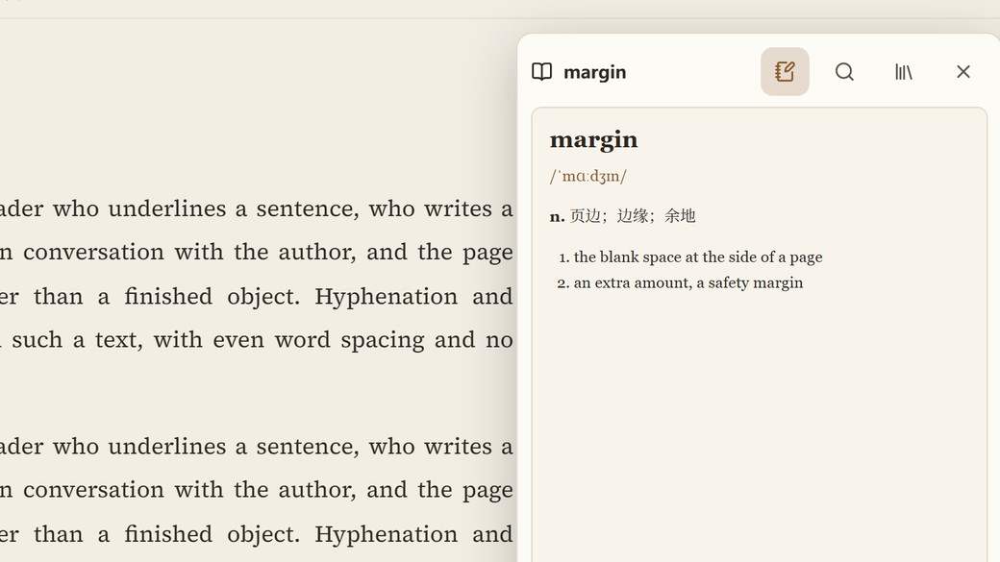

# 墨边 · Marginalia 使用指南

### 读、记、想、做：一本写给精读者的个人生产力手册

> **信息唾手可得的年代，稀缺的是专注，和真正读懂的能力。**
>
> 墨边陪你把好书读透、把想法留在原文旁边，再把收获落成目标和待办——**精读，是为了更好地用时间。**

> 这本手册里的截图使用的都是虚构的示例材料，其中的人物和场景是为了说明用法而设想的，不是真实用户的故事。另有一份 31 页的介绍 PPT（PDF）：[docs/marginalia-intro.pdf](docs/marginalia-intro.pdf)。

---

## 这本手册怎么读

全书分五个部分，顺序和介绍 PPT 一致，但每一章都写得更细：

- **第一部分　为什么需要它**（第 1–3 章）：我们到底在哪里丢掉了读过的东西，现有工具各缺什么，以及墨边的立场。
- **第二部分　设计理念**（第 4–7 章）：一条链路、四个原则，以及这些原则落到技术上是什么样子。
- **第三部分　核心功能**（第 8–14 章）：读、记、想、做、回顾，加上「安心」和插件。每一章都先讲「为什么这样设计」，再讲「怎么用」，最后是几句要点。
- **第四部分　不同的人怎么用**（第 15–22 章）：大学生、职场人士、自由职业者、研究者、家长、读经的人、语言学习者，以及串起所有功能的「一个人的一周」。
- **第五部分　开始**（第 23–26 章）：五分钟上手、习惯、常见问题，以及附录。

时间很紧的话，只读第 23 章「五分钟上手」就能开始用；想弄明白它为什么长这样，读第二部分；想看和自己最像的人怎么用，直接翻到第四部分。

**目录**

- [引子：一个读完就忘的下午](#引子一个读完就忘的下午)
- 第一部分　为什么需要它
  - [第 1 章　读过的东西，去了哪里](#第-1-章读过的东西去了哪里)
  - [第 2 章　工具各管一段](#第-2-章工具各管一段)
  - [第 3 章　AI 时代，更要精读](#第-3-章ai-时代更要精读)
- 第二部分　设计理念
  - [第 4 章　一条链路：读、记、想、做、回顾、输出](#第-4-章一条链路读记想做回顾输出)
  - [第 5 章　四个原则](#第-5-章四个原则)
  - [第 6 章　笔记为什么不会丢、不会错位](#第-6-章笔记为什么不会丢不会错位)
  - [第 7 章　核心做稳，专业内容做成插件](#第-7-章核心做稳专业内容做成插件)
- 第三部分　核心功能
  - [第 8 章　读：一个安静的阅读器](#第-8-章读一个安静的阅读器)
  - [第 9 章　记：划线、想法、整体笔记与公式](#第-9-章记划线想法整体笔记与公式)
  - [第 10 章　想：把笔记整理成体系](#第-10-章想把笔记整理成体系)
  - [第 11 章　做：待办、目标与四象限](#第-11-章做待办目标与四象限)
  - [第 12 章　回顾：让旧笔记回来找你](#第-12-章回顾让旧笔记回来找你)
  - [第 13 章　安心：数据始终带得走](#第-13-章安心数据始终带得走)
  - [第 14 章　插件：词典、圣经研究与云同步](#第-14-章插件词典圣经研究与云同步)
- 第四部分　不同的人怎么用
  - [第 15 章　大学生与考生](#第-15-章大学生与考生)
  - [第 16 章　职场人士](#第-16-章职场人士)
  - [第 17 章　自由职业者](#第-17-章自由职业者)
  - [第 18 章　研究者与长期写作者](#第-18-章研究者与长期写作者)
  - [第 19 章　在家教育孩子的父母](#第-19-章在家教育孩子的父母)
  - [第 20 章　读经与人文阅读者](#第-20-章读经与人文阅读者)
  - [第 21 章　语言学习者与终身学习者](#第-21-章语言学习者与终身学习者)
  - [第 22 章　一个人的一周](#第-22-章一个人的一周)
- 第五部分　开始
  - [第 23 章　五分钟上手](#第-23-章五分钟上手)
  - [第 24 章　让它越用越顺手的五个习惯](#第-24-章让它越用越顺手的五个习惯)
  - [第 25 章　常见问题](#第-25-章常见问题)
  - [第 26 章　附录：快捷键、搜索语法与文件位置](#第-26-章附录快捷键搜索语法与文件位置)
- [结语](#结语)

---

## 引子：一个读完就忘的下午

设想这样一个周日下午。你泡了茶，把一本想了很久的书读完了最后一章。合上书的时候，你觉得自己懂了不少，甚至在脑子里默默列了几条「以后要这样做」。

两个月后，同事问起这本书讲了什么。你张了张嘴，只说出了书名，和一个模糊的感觉：「挺有启发的」。

那几条「以后要这样做」呢？没有写下来，就和那个下午一起过去了。

这不是你不够用功。这是**阅读本身的结构性问题**：读的时候最投入，读完的瞬间理解最深，而我们几乎没有任何机制，把这一刻的理解固定下来，再在它淡去之前一次次地唤醒它。

后来你学聪明了。你开始划线，开始收藏文章，开始在备忘录里记几句想法，开始用待办软件排日程。工具越来越多，问题却换了一种形式：划线留在书里，没法汇总；收藏的文章越攒越多，没有一篇读完；备忘录里的想法沉了底；待办清单里排满了和你正在读的东西毫无关系的事。

读、记、想、做，本来是一件事的四个面，却被拆给了四个互不相识的工具。

墨边想做的，就是把它们重新接起来。这本手册会告诉你它为什么这样设计，以及怎么把它用顺。

---

# 第一部分　为什么需要它

## 第 1 章　读过的东西，去了哪里

如果把「读过就忘」拆开看，你会发现它至少有六个不同的出口。每一个出口，都是一个可以被修补的漏洞。

### 漏洞一：读过就忘

一本书读完，两个月后只剩书名。划过的线、当时的想法，都没有留下来——或者留下来了，却淹没在书里，你再也不会翻开那一页。

**墨边的补法**：划线和想法留在原文旁边，点一下就回到那一页；每天自动抽几条旧笔记请你回顾，在遗忘发生之前把它拉回来。

### 漏洞二：收藏从不回头

收藏夹、稍后读、转发给自己的文章越攒越多。收藏的那一刻，大脑会给你一个「已经读过了」的错觉，于是你就不再读它。

**墨边的补法**：网页直接存成离线文章，和书放在同一个书架里。它不再是一个「待会儿再看」的链接，而是一本你的书架上的书，读完要留下笔记。

### 漏洞三：想法散落各处

备忘录、聊天记录、纸条上都有一点，要用的时候，一条也找不到。

**墨边的补法**：一个「随手记」输入框，想到什么写什么，Ctrl+Enter 发送；用 `#标签` 归类，不必当场想好放在哪里。

### 漏洞四：读书和做事是两张皮

读书笔记是一回事，待办清单是另一回事。读到一个好做法，写进了笔记，却永远没有变成待办。

**墨边的补法**：笔记里的一句话可以直接变成待办，待办挂到本月目标下，读书的收获顺着这条线落到行动里。

### 漏洞五：笔记越记越多

记得多，找不到。没有标签体系，也没法按主题回头看一遍。

**墨边的补法**：多级标签树、全文搜索、Ctrl+K 一键找到任何东西，连书里的原文也能搜。

### 漏洞六：担心数据出不来

软件停服、账号出问题，多年的积累可能带不走。

**墨边的补法**：数据都在你自己的电脑上，笔记可导出为普通 Markdown，数据库可定时备份，删除的内容保留 30 天。

### 一张对照表

| 你遇到的情况 | 墨边怎么帮你 |
|---|---|
| 读过就忘 | 划线和想法留在原文旁边，点一下回到那一页；每天自动抽几条旧笔记请你回顾 |
| 收藏从不回头 | 网页直接存成离线文章，和书放在同一个书架里，读完留下笔记 |
| 想法散落各处 | 一个「随手记」输入框，写完按 Ctrl+Enter；用 #标签 归类 |
| 读书和做事是两张皮 | 笔记里的一句话可以变成待办，待办挂到本月目标下 |
| 笔记越记越多 | 多级标签树、全文搜索、Ctrl+K 一键找到，连书里的原文也能搜 |
| 担心数据出不来 | 笔记可导出为普通 Markdown，数据库可定时备份，删除的内容保留 30 天 |

> **本章要点**
> - 「读过就忘」不是你的问题，是流程缺了几个环节。
> - 六个漏洞：读过就忘、收藏不回头、想法散落、读书和做事脱节、笔记找不到、数据出不来。
> - 墨边的每个功能，都对应其中一个漏洞。

---

## 第 2 章　工具各管一段

先说清楚一件事：下面这些工具都很好。问题不在于它们不好，而在于**它们各管一段**，而你的思考是连续的。

*墨边的阅读界面：正文被划线，两侧是对应的笔记卡片。读、记、想在同一个画面里。*

### 阅读器

**擅长**：把书读下去，划线、高亮。
**缺的是**：划线留在书里，没有标签，没有关系，也变不成待办。
**结果**：读完只剩一片黄色，没有变成自己的东西。

### 笔记软件

**擅长**：记录与整理，搜索也强。
**缺的是**：和原文脱节。回头看，你看不出这句话出自哪一页。
**结果**：笔记像无根的摘抄，想复查原文得重新翻。

### 待办软件

**擅长**：排日程、做提醒。
**缺的是**：和你正在读、正在想的内容没有联系。
**结果**：读到的好做法，永远停在「有空试试」。

### 墨边的做法

让读、记、想、做发生在**同一个地方**，并且**彼此相连**：

- 你在正文里划线、写想法——这是「读」和「记」；
- 这条想法连着原文，也可以连着别的想法——这是「想」；
- 想法里的一句话变成待办、挂上目标——这是「做」；
- 过些天它又自己回来找你——这是「回顾」。

它**不是**什么：不是网盘，不是在线协作文档，不是 AI 助手。它是一个安静、属于你个人的阅读和思考工作台。

> **本章要点**
> - 阅读器、笔记软件、待办软件各管一段，你的思考却是连续的。
> - 墨边把读、记、想、做放在同一个地方，并让它们彼此相连。
> - 它不是网盘、协作文档或 AI 助手。

---

## 第 3 章　AI 时代，更要精读

这一章讲墨边的立场。读完它，你会明白很多设计取舍的来由。

### 一个越来越诱人的捷径

现在想知道一件事，问 AI 几秒钟就有答案：总结一篇文章、概括一本书、列出要点。这很方便，也确实有用。

但有一个地方要提防：**如果什么信息都靠 AI 来读、来总结，自己就少了「读懂、想明白、记住」这个过程。** 长期下去，专注力、理解力和记忆力都可能退化。这个过程不能被代劳，因为它本身就是学习。

打个比方：让别人替你锻炼，你不会变强壮；让 AI 替你读书，你也不会变明白。

### 墨边的立场：不替你读书

墨边做的是相反的事：帮你把书**慢慢读完、读透**，并把读的收获留下来。下面是几条具体的做法，贯穿整本手册：

1. **AI 摘要适合「决定要不要读」，不适合「代替读」。** 先用摘要判断一篇文章值不值得花时间；值得的，就自己从头读一遍。
2. **重要的东西，自己动手划线、写想法。** 用自己的话写一句「这段话说了什么、我怎么看」，比读十遍摘要都管用。
3. **别只收藏不读。** 存下来的网页和文章，设一个每周读完的目标；读不完的，宁可删掉。
4. **用「笔记回顾」让知识留在脑子里，而不是留在手机里。** 每天回顾几条自己写的笔记，是在训练记忆。
5. **先自己想，再去问。** 读到不懂的地方，先写下你的猜测和疑问，再去查资料或问 AI，最后把得到的答案**用自己的话**补进笔记。
6. **把 AI 当作对话的对象，不当作答案的来源。** 它可能出错，也可能一本正经地说错；你读过原文、有自己的笔记，才有能力判断。

### 给两类读者的话

**对学生**：作业、论文和复习，最容易被「让 AI 总结一下」取代。短期省事，长期的代价是自己没有真正学会，考试和以后的工作都没有 AI 在旁边。建议：教材、论文自己读完并批注，AI 只用来检查自己的理解、解答卡住的问题，而不是直接要结论。

**对在家教育的家长**：您的学习和积累，是孩子最直接的榜样。孩子看到的是您怎么读书、怎么做笔记，而不是您转发了多少总结。建议：每天留出固定时间，和孩子各读各的书，各记各的笔记；再一起聊聊。教材和读物自己先读一遍，笔记里写下您自己的理解，再决定怎么教。AI 可以帮您备课找资料，但不要用它替代您对内容本身的理解。

> **试一试**：挑一篇你最近收藏、还没读的文章。先别问 AI。从头读完，划三处线，用自己的话在其中一处写一句「我怎么看」。再决定要不要让 AI 帮你检查理解。

> **本章要点**
> - 「读懂、想明白、记住」不能被代劳，它本身就是学习。
> - 摘要决定要不要读，不替代读；先自己想，再去问；把 AI 当对话对象，不当答案来源。
> - 墨边不替你读书，它帮你把书读透，并把收获留下来。

---

# 第二部分　设计理念

## 第 4 章　一条链路：读、记、想、做、回顾、输出

好的工作流有一个共同点：每一步的产物，正好是下一步的原料。墨边把阅读之后的事情，排成一条链路。

| 环节 | 它回答的问题 | 墨边里怎么做 |
|---|---|---|
| **读** | 我在读什么？ | EPUB、PDF、Markdown、TXT、网页文章，自动记住读到哪里 |
| **记** | 我想到了什么？ | 划线、框选区域、整体笔记、随手记；LaTeX 公式也能写 |
| **想** | 这些想法之间是什么关系？ | 多级标签归类；笔记之间连线，写明是支持、反驳还是举例 |
| **做** | 所以我要做什么？ | 笔记里的一句话一键变待办，挂到月度目标；四象限排优先级 |
| **回顾** | 我还记得吗？这周我做了什么？ | 按遗忘规律每天重读几条旧笔记；每周盘点读了什么、做了什么 |
| **输出** | 我能把它用起来吗？ | 按标签或筛选结果导出 Markdown，在 Obsidian 等软件里直接打开 |

### 为什么要排成一条线

如果每个环节都在不同的软件里，环节之间就会出现「搬运」：把划线复制到笔记软件，把笔记里的行动抄进待办。搬运有成本，成本一高，人就偷懒，链路就断了。

墨边的做法是**让产物自然流动**：

- 划线直接变成笔记，笔记自带出处；
- 笔记里的一句话，一键变成待办；
- 待办挂上目标，目标自己算进度；
- 笔记过些天自己回到你面前；
- 想用的时候，按标签导出。

链路上每一步都不需要你「搬」，你只需要做那件只有你能做的事：**想**。

> **本章要点**
> - 阅读之后的事情是一条链路：读 → 记 → 想 → 做 → 回顾 → 输出。
> - 环节之间不需要搬运，产物自然流动。
> - 你只需要做只有你能做的事：想。

---

## 第 5 章　四个原则

### 原则一：笔记连着原文

每条笔记同时记下它在原文中的位置和前后文。改字号、缩放窗口都不会错位，点一下就回到那一页、那一行。

**为什么重要**：脱离出处的笔记，价值会迅速下降。三个月后你再看到一句「这个观点很重要」，如果不知道它从哪来、前后在说什么，它就是一句空话。连着原文的笔记，永远可以追问：这话在什么语境里说的？

### 原则二：想法之间可以连线

给两条笔记连线，并写下它们为什么相关：支持、反驳、举例、延伸……关系是**多对多**的网：一条笔记可以连任意多条，同一对笔记之间还能有多条关系，每条写一句说明。

**为什么重要**：知识不是一条条孤立的记录，而是一张网。把关系写出来，是一次真正的思考；而当你积累了足够多的连线，关系图会让你看到：哪里观点在碰撞，哪里有孤零零的想法等着被接上。

### 原则三：旧笔记会回来找你

按遗忘规律安排间隔，从 1 天到 240 天。读完选「忘了 / 模糊 / 记得」，系统决定下次什么时候再见。

**为什么重要**：记忆有规律：刚学完忘得快，之后越来越慢，每次想起来，保持的时间就更长。与其靠自觉去「复习」，不如让系统在合适的时候把笔记递到你面前。

### 原则四：数据留在自己手里

不注册账号，不联网也能用。笔记存在本机，可导出为普通 Markdown，数据库可定时备份。

**为什么重要**：个人知识库是用几年甚至几十年积累的。它应该比任何一个软件、任何一家公司活得更久。普通的 Markdown 文件，永远能被别的软件打开。

> **本章要点**
> - 连着原文、可以连线、会回来找你、留在自己手里。
> - 每一条原则都在回答同一个问题：怎样让积累真正变成你的东西。

---

## 第 6 章　笔记为什么不会丢、不会错位

前面说「改字号也不会错位」，这一章解释它是怎么做到的。你不必记住这些细节，但知道它们存在，会让你更放心地把长期的积累交给它。

### 双重定位

一条笔记要「贴」在原文的某个位置上。最直接的办法是记一个数字：「第几个字」。问题是，一旦字号变了、排版变了，这个数字就指错了地方。

墨边同时用**两种线索**来定位：

- **位置线索**：第几个字；
- **内容线索**：这句话的原文，及其前后文。

就像你向别人描述一个地点，既说「在第三个路口左转」，也说「在那家红色招牌的面包店旁边」。任何一种线索失效了，另一种仍然能把你带回去。技术上，这采用了 W3C Web Annotation 的思路。

### 区域批注按比例保存

扫描版 PDF 只有图片，没有文字可以定位。这时你直接用鼠标框选一块区域，墨边按**页面比例**记录这个框的位置，所以缩放窗口、改变界面大小，框始终贴在原来的地方。框住的内容还会截成一张图片，放进笔记卡片、笔记页和每日回顾里；导出 Markdown 时，以 `![[图片]]` 嵌入，并注明页码。

### 记得读到哪里

自动记住阅读位置，与字号无关。书里搜文字时，所有匹配处会同时用红框标出，右侧给出目录式列表，点哪个跳哪个。

> **本章要点**
> - 位置线索加内容线索，双重定位，改字号也不会错位。
> - 扫描件的区域批注按页面比例保存，缩放也贴得住。
> - 你只管记，位置的事交给它。

---

## 第 7 章　核心做稳，专业内容做成插件

一个工具怎样才能「又简单又够用」？墨边的答案是一条取舍标准：

> **多数人都要用的，做成核心；少数人才需要的，做成插件。**

### 核心：多数人都会用

- **阅读与划线**：EPUB、PDF、Markdown、TXT、网页。
- **笔记、标签与关系图**：多级标签、组合搜索、笔记连线。
- **待办、目标与四象限**：笔记里的一句话可一键变待办。
- **笔记回顾与每周回顾**：按遗忘规律安排，周日收个尾。
- **LaTeX 公式与实时预览**。

### 插件：少数人才需要，按需开启

- **词典**：加载你自己的 MDict 词典，选词即查，一键存入笔记。
- **圣经研究**：按卷阅读、三种对照、经文引用悬浮预览、读经计划。
- **云同步**：开发中，默认关闭。

插件在「设置 → 插件」里开关。不用的时候，它们不占用你的界面，也不会让你的工具栏变得拥挤。

### 为什么这样做

每个功能都有人需要，但**每个功能都会增加界面的复杂度**。如果把词典、圣经、各种专业工具都塞进核心，大多数人就会被他们用不到的东西包围。墨边宁愿让核心保持克制，把专业的东西放在需要的人伸手能够到的地方。

> **本章要点**
> - 取舍标准：多数人都要用的是核心，少数人才需要的是插件。
> - 插件在「设置 → 插件」里开关，不用时不占用界面。
> - 核心保持克制，专业内容按需开启。

---

# 第三部分　核心功能

## 第 8 章　读：一个安静的阅读器

> 阅读是整条链路的起点。如果起点就是嘈杂的，后面的一切都白搭。

### 设计思路

正文居中，笔记落在两侧页边。就像一本摊开的纸书，你在空白处批注，而不是被弹窗和侧栏打断。界面尽量退后，把注意力还给文字。

### 它能读什么

- **EPUB**（EPUB 2/3，含目录、图片、内部链接）
- **PDF**（懒渲染 + 文本层，CJK 字库离线内置；扫描版也能用）
- **Markdown**、**TXT**（自动识别 GBK 编码，按「第X章」切章）
- **网页文章**（保存为离线快照，见下文）

### 舒适地读

- **三种外观**：纸张、素白、夜读；另有柔绿、羊皮纸、棕色夜间三个主题。
- **三种字体**：宋体、楷体、黑体。字号、行距可调（Ctrl +/-）。
- **顶栏随滚动自动隐藏**，读到哪里自动记住，与字号无关。
- **沉浸模式**：隐藏全部页边，只剩正文。

### 扫描版和图片

扫描版 PDF（只有图片）可以直接用鼠标**框选**一块区域做批注。有文字的页面，按住 Alt 拖，或点顶栏「框选」按钮后拖。EPUB、网页文章、Markdown 里的图片（包括 SVG 插图、封面、带链接的图），也可以直接在上面拖出一个框。

### 在书里搜文字

书架上的书和文章的**正文**可以搜索：

- 按 Ctrl+K，输入词，结果里的「书中文字」分组会列出命中的那一句。
- 打开后，这本书里**所有**命中的地方会同时用红色细框框出，右侧给出目录式列表，点哪个跳哪个。

### 读了多久，也记着

读书时自动记录**真正在读的时间**：窗口在前面、有焦点、最近几十秒内有操作才计时（设置里可调整或关闭）。每本书的阅读面板里能看到累计时长、天数、速度、预计读完日；书架顶部是阅读热力图。

### 订阅与保存网页：不被推荐流带跑

你每天读的东西，一部分来自书，一部分来自网络。墨边把后者也请进同一个书架：

- **订阅**：输入网站或博客地址，自动发现 RSS、Atom、JSON Feed；也支持公众号「合集」链接、批量粘贴和导入 OPML。新文章汇成一个收件箱，每 30 分钟自动更新。喜欢的，一键存成离线文章。
- **保存网页**：书架上点「保存网页」，或直接在书架上 Ctrl+V 网址。提取正文，图片内嵌成离线快照；适配微信公众号（懒加载图片、防盗链、作者与发布时间）和 GBK 老站点；同一网址自动去重。
- **阅读兴趣**：给书和订阅来源标注「阅读兴趣」（如 AI、法律、历史），在侧栏按兴趣筛选；订阅保存的文章自动继承来源的兴趣。
- **来源列表**：笔记页和收件箱左侧的「来源」默认显示 15 个，其余在「更多来源」里展开；当前选中的来源始终可见。

订阅和保存网页只会访问你指定的网站，不会上传你的笔记。

### 书架

书架可以在「封面」和「列表」之间切换。封面按文档类型统一配色：PDF 梅紫、EPUB 琥珀金、Markdown 蓝、TXT 石墨灰、网页青绿。顶部有搜索框，可以批量选择，一次给多本书加阅读兴趣、设为想读 / 在读 / 读完。「继续阅读」列出最近打开的 3 本。

> **试一试**：把你电脑里的一份 PDF 拖进窗口。双击打开，选中一段话，点「笔记」，写一句「这段话说了什么」。然后关掉再重新打开：你会回到刚才读到的地方。

> **本章要点**
> - 正文居中，笔记在页边；界面退后，注意力还给文字。
> - EPUB、PDF、Markdown、TXT、网页都能读，扫描版框选批注。
> - 订阅和保存网页让「待会儿看」变成书架上的一本书。

---

## 第 9 章　记：划线、想法、整体笔记与公式

> 记，不是抄。划线只是标记，想法才是记录。

### 划线：10 种配色 × 12 种样式

选中一段文字，工具条会出现。你可以选**颜色**和**样式**：

- 高亮、马克笔
- 下划线、双底线、波浪线、虚线、点线
- 着重号
- 框选、圈注、侧线、删除线

为什么要这么多？因为**颜色和样式本身就是一种分类**。你可以约定：黄色表示「考点」，蓝色表示「不懂」，红色表示「易错」。之后用组合搜索一次看完所有易错点。

### 页边笔记：想法落在页面两侧

选中文字后点「笔记」，想法会出现在页面边上，对齐原文所在的那一行。按窗口宽度自动切换三档：

- **宽窗口**：双侧页边，自动平衡分配，也可以逐条固定到某一侧；
- **较窄**：单侧页边；
- **窄屏**：收起为页边色条，点开从底部抽屉编辑。

只有写了想法或标签的笔记才占页边，所以单纯的划线不会把页面挤满。

*选中文字，选颜色和样式，再写一句自己的话。*

### 整体笔记：对一整本书的看法

除了针对某段文字的笔记，每本书、每篇文章还能写多条**整体笔记**，带标签、按时间排列。阅读页右侧页边顶部有固定卡片，顶栏也有入口。面板里同时可以给书打 1–5 星，标记「想读 / 在读 / 读完」。

整体笔记是写「这本书整体说了什么、对我有什么用」的地方。读完一本书，写一条整体笔记，比划十条线更有价值。

### 随手记：没有原文的想法

不是所有想法都来自某本书。笔记中心顶部有一个写作框，专门记与书籍、文章无关的普通想法：

- 行内输入 `#标签/子标签`，输入 `#` 时会弹出候选；
- Ctrl+Enter 发送，草稿自动保存；
- 左侧栏顶部的热力图，一天一个方块，点击按日筛选。

### 笔记里能放什么

- **格式**：粗体、斜体、下划线、删除线、项目符号和编号列表（回车自动续行）；
- **图片**：截图直接 Ctrl+V，也可以拖入图片文件，每条最多 9 张，过大的自动缩到 2000 像素以内；
- **待办**：笔记里的一行字可以变成待办；
- **公式**：见下文。

所有格式都以普通文字保存，所以搜索、标签、Markdown 导出和备份都不受影响，导出后在 Obsidian 里同样生效。

### 公式：LaTeX 书写，实时预览

精读理工科教材时，笔记里终于能写公式了。

*上面是你写的 LaTeX，下面是保存后会显示的样子。*

- **写法**：行内公式写 `$x^2+y^2$`；独立公式写 `$$a^2+b^2=c^2$$`。矩阵、方程组等常用写法都支持，用 KaTeX 离线渲染。想写一个普通的美元符号时，写 `\$`；`$5 和 $10` 这样的金额不会被当成公式。
- **预览**：编辑框右下角的「预览」，显示整条笔记保存后的样子（格式、列表、待办、标签、公式）。默认收起；笔记里有公式时自动展开，手动收起后在这个编辑框里保持收起。
- **容错**：写错的公式会用红色源码提示，不影响其余内容。
- **到处可见**：笔记卡片、回顾页、桌面卡片、每周回顾里都渲染成公式。图谱节点、搜索结果这类单行摘要仍显示源码。
- **提醒**：公式里不要写 `#`，笔记里的 `#` 会被当作标签。

> **试一试**：在任意一条笔记里写 `设 $A$ 是 $n$ 阶方阵，则 $$\det(A - \lambda I) = 0$$`，看看下面的预览。

> **本章要点**
> - 划线是标记，想法才是记录；颜色和样式本身就是一种分类。
> - 整体笔记写对一本书的看法；随手记写没有原文的想法。
> - 公式用 `$…$` 和 `$$…$$`，边写边预览。

---

## 第 10 章　想：把笔记整理成体系

> 记下来只是开始。让笔记彼此相识，才是「想」。

### 笔记中心：所有笔记汇在一处

所有批注和随手记，自动汇到「笔记中心」。

*左边是标签树和来源，右边是笔记卡片。*

### 多级标签

笔记正文里写 `#读书/方法`，就是一个两级标签。标签跨书通用：

- 点**父标签**自动包含所有子标签；
- 标签可以**置顶、改名、移动、合并、移除**；
- 输入 `#` 时会从全局标签里补全。

**怎么设计标签？** 一条经验：一级标签控制在十个以内，细分用子标签。比如 `#工作/项目A/复盘`、`#成长/管理`。标签是「找回」的入口，不是「分类」的牢笼，不必一次想好。

### 标签主题页

点一个标签，就进入它的**主题页**：围绕这个主题的所有笔记、相关的书、待办和目标、时间分布，全部放在一起。侧栏「标签」标题右边的「标签主题」是总览，每个顶级标签一张卡片，显示笔记数、待办数和进度。

每周花十分钟看一个主题页，是让笔记「流动」起来的最好办法。

### 组合搜索

搜索框里可以组合条件：

| 写法 | 含义 |
|---|---|
| `#高数` | 带这个标签 |
| `书:线性代数` | 来自这本书 |
| `色:琥珀` | 某个颜色 |
| `样式:波浪线` | 某种划线样式 |
| `有想法` | 只看写了想法的笔记 |
| `类型:随手记` / `类型:整体` | 按笔记类型 |

可以和关键词任意组合，例如 `#线性代数 色:琥珀 特征值`。常用的筛选，点搜索框旁的 ☆ 存起来，侧栏一键恢复。

### 笔记之间连线

给两条笔记**连线**，并写下一句说明——支持、反驳、举例、出处、延伸，或随便写。

*示例：汇报材料里的五条笔记，如何指向同一个结论。*

- **怎么连**：笔记卡片底部的链条图标，点「连接笔记」（可搜索并多选），或「新建相关笔记」（写一条新笔记并自动连接）。在关系图里，把一张卡片拖到另一张上松手，填写关系；或拖卡片右侧的橙色圆点到另一张卡片。
- **多对多**：一条笔记可连任意多条，同一对笔记之间还能有多条不同的关系。
- **看得清**：4 种连线样式（弧线、流线、圆角折线、直线）、11 种颜色，实线、虚线、点线；画线时自动避开其他连线和无关的卡片；工具栏「整理」按「尽量少交叉」重排所有卡片。
- **看局部**：按标签筛选，或右键卡片「只看它的邻居」（1–3 度）；滚轮缩放，拖空白处平移；点右上角「全屏」（或按 F）铺满整个窗口，Esc 退出。
- **删掉连线不会删掉笔记**：选中一条线按 Delete，或点线上的文字修改、删除。

**为什么要写关系？** 因为「写出关系」本身就是思考。当你被迫回答「这条笔记和那条是什么关系」，你其实在回答「我真的理解它们吗」。

> **试一试**：打开笔记中心，找两条看起来有点关系的笔记，连起来，写一个字：「支」或「驳」。再打开关系图看看。

> **本章要点**
> - 标签是找回的入口，宁少勿多，细分用子标签。
> - 主题页把一个标签下的一切放在一起，每周看一次。
> - 连线并写下关系，是一次真正的思考。

---

## 第 11 章　做：待办、目标与四象限

> 如果读书的收获不能落到行动里，它就只是一种知识性的消遣。

### 从笔记到待办

笔记里的一行字，可以一键变成待办。写待办时还可以直接用「@下周」「截止周五」这样的写法，空格之后自动换成具体日期。笔记和待办保持双向同步：在任务页改了，笔记里对应的那一行也跟着改。

### 清单：今天做什么

任务页侧栏有「今天」「近 7 天」「本周」「逾期」「全部」「已完成」「没有目标」等清单，加上按标签筛选。

### 目标：待办为什么而做

待办不是孤立的。把它们挂到**目标**下：

*目标：任务挂到月度目标上，进度自动计算，落后于时间会变红。*

- **本月目标**、**年度目标**，每个目标按进度显示百分比；
- 任务挂上去，进度**自动计算**；
- 如果进度**落后于时间**，百分比会变红，提醒你该动手了；
- 桌面小卡片上也一样。

### 四象限：先做哪件

*四象限：重要线和紧急线都可调整。*

事情很多的时候，最难的不是「做」，而是「先做哪件」。四象限把待办按**重要**和**紧急**分到四个格子：

- **重要且紧急**：马上做；
- **重要不紧急**：计划做（这是最值得花时间的格子）；
- **不重要但紧急**：快速处理；
- **不重要不紧急**：考虑推迟。

「重要线」（比如「中及以上」）和「紧急线」（比如「7 天内」）都可以调整。把任务**拖进「紧急」格**，会自动排到近几天；格子的大小随任务数变化，分隔线也可以手动拖。

> **试一试**：在任务页添加三件事，其中一件设成高优先级、周五截止。打开四象限，看它落在哪个格子。

> **本章要点**
> - 笔记里的一行字能变成待办，双向同步。
> - 待办挂到目标下，进度自动算，落后会变红。
> - 四象限帮你决定先做哪件，最值得投入的是「重要不紧急」。

---

## 第 12 章　回顾：让旧笔记回来找你

> 记下来不等于记住。回顾，是把「存起来」变成「在脑子里」的最后一步。

### 笔记回顾：按遗忘规律安排

*读完一条，选「忘了 / 模糊 / 记得」。*

笔记页侧栏的「笔记回顾」，按遗忘规律安排每天该重读哪几条笔记。

**哪些笔记会进来**：所有有内容的笔记（含只划线没写想法的）；带排除标签的不进（默认排除 `Status/待办复盘` 和周回顾标签）。新写的笔记，第二天第一次出现。

**怎么读**：一次一条。读完选：

- **忘了**：退两级，很快再见；
- **模糊**：原地不动；
- **记得**：升一级，间隔拉长。

间隔依次约 **1、3、7、14、30、60、120、240 天**，带一点随机错开，避免一天扎堆。键盘上按 1 / 2 / 3 更快；还可以选「明天再看」或「不再回顾」。

**每天几条**：在「设置 → 通用 → 笔记回顾」里选 3、5、10、20 或不限（默认 5），超出的顺延；可设置排除标签、「新的一天从几点开始」（默认凌晨 4 点）、一键重置进度。

**别处也能看到**：笔记页侧栏有今天还剩几条的角标；桌面卡片有待回顾的笔记时只显示它，下面是三个评分按钮；周回顾里有一行「回顾了 N 条，记得 X%」。

### 每周回顾：把这周收个尾

*先看数据，再回答三个问题，最后落到下周要做的事。*

任务页侧栏的「周回顾」，汇总这一周：

- **阅读**：读了多久、读了几天、读完了哪本；
- **笔记**：挑出最值得重读的几条；
- **待办与目标**：完成了多少、哪些落后；
- **三个问题**：学到并想保持什么？有什么遗憾和问题？对下周有什么想法？

你的回答存成一条带标签的随手记（默认标签 `#Lifelog/WeeklyReview`，可在设置里改）。其中「下周先做哪一件」直接成为下周的待办。

这是整条链路里**闭环**的地方：本周的总结，成了下周的起点。

> **试一试**：这个周日，花十分钟打开周回顾，回答三个问题，写下「下周先做哪一件」。

> **本章要点**
> - 笔记回顾按遗忘规律安排，读完选忘了、模糊、记得。
> - 间隔从 1 天到 240 天，每天回顾几条就够。
> - 每周回顾是闭环：本周的总结，是下周的起点。

---

## 第 13 章　安心：数据始终带得走

> 个人知识库用的是几年、几十年。它应该比任何软件都活得久。

### 回收站

删除的笔记和待办，先进回收站，**保留 30 天**，之后彻底删除。恢复时，笔记连同它的关系线、回顾进度、由它转出的待办一起回来。删除前会弹出「移到回收站？30 天内可以恢复」，勾上「以后不再询问」，之后只在窗口下方轻提示一下。

### 备份

- 数据库可以**定时备份**，也可以立即备份一次，备份位置自己指定；
- 建议把备份目录放在你信任的地方，例如另一块硬盘。

### 导出

- 笔记可以导出为**普通 Markdown**：当前筛选结果或所选笔记，标签原样保留，Obsidian 能识别多级标签；
- 框选的区域以 `![[图片]]` 嵌入并注明页码；
- 每条笔记下追加「相关笔记」清单。

### 桌面小卡片

把「每日回顾」和「今日待办」放在桌面上，开机后一眼看到今天的待办和一条旧笔记，点一下回到软件里对应的位置。关闭主窗口时可以收到托盘。

### 其他

- **三种界面语言**：简体中文、繁體中文、English，默认跟随系统；
- **数据位置**：Windows 上新安装的数据在 `%APPDATA%\Marginalia`；
- **书中文字索引**：放在单独的文件里，可随时重建，不进备份。

> **本章要点**
> - 删除的内容保留 30 天，恢复时连关系和进度一起回来。
> - 定时备份，Markdown 导出，数据永远带得走。
> - 一切都在你自己的电脑上。

---

## 第 14 章　插件：词典、圣经研究与云同步

插件在「设置 → 插件」里开关。它们是为少数人准备的，不用的时候不占用界面。

### 词典

**适合谁**：读外语原文、读专业文献，需要随手查词的人。

*图中的词条是示例，不是真实词典内容。*

- 加载你自己的 **MDict** 词典（可多本），在设置里可排序、停用、移除；
- 选中单词，工具条上点「查字典」，释义显示在页边，不离开正文；
- 支持**词形还原**（running 会查到 run），汉语支持最长匹配；
- 一键**摘录到笔记**：单词和简短释义，默认标签「词汇」，可在设置里改标签；
- Ctrl+K 里也能查词。

词典需要你自己准备并加载。

### 圣经研究

**适合谁**：读经、做灵修与研经的人。

- **按卷阅读**：66 卷分旧约、新约，内置和合本（简体）与 World English Bible；
- **印刷版式**：保持分段和诗歌分行，节号用小数字标注；
- **三种对照**：节号气泡、行间、并排，可切换；
- **整节笔记**：各译本通用；
- **引用预览**：笔记里写「约 3:16」，鼠标悬停就显示经文；Ctrl+K 输入经文引用可直接跳转；
- **读经计划**：如「一年读完圣经」，每天一条待办，没读的留在「逾期」里。

ESV 等有版权的译本不内置。该插件默认隐藏，在设置的插件区域**连续点击 5 次**显示。

### 云同步

**开发中，默认关闭。** 现在换电脑请用备份。

> **本章要点**
> - 词典：加载你自己的 MDict 词典，选词即查，一键存入笔记。
> - 圣经研究：按卷阅读、对照、引用预览、读经计划。
> - 云同步还在开发中。

---

# 第四部分　不同的人怎么用

前面讲的是「是什么」和「为什么」。这一部分换个角度：八种不同的人，各自会怎样把墨边用进自己的生活。每个场景都是**设想**，目的是给你一个对照，找到和自己最像的那一个，借走它的做法。

## 第 15 章　大学生与考生

**场景**：教材、论文 PDF、课程讲义、考研资料，期末前要把所有东西串起来。定义、定理、例题混在一起，读完不知道重点；公式没处记。

**核心思路**：一门课一个标签，颜色分层，复习靠回顾，不靠突击。

| | |
|---|---|
|  **一门课一个标签**：`#线性代数/定义`、`/定理`，点一下标签，这门课的笔记就汇齐了。 |  **颜色分层、组合搜索**：琥珀标考点，天青标不懂，玫瑰标易错；搜「色:琥珀 #线性代数」。 |
|  **公式照写**：用 LaTeX 写推导，下方实时预览；扫描版教材就框选公式，保存成截图笔记。 |  **每天十分钟回顾**：读完选「忘了 / 模糊 / 记得」，比考前突击轻松。 |

### 具体做法

1. **导入教材**：PDF、讲义、电子书都行。按章节读，不求一口气读完。
2. **一门课一个标签**：批注时顺手打上 `#高数`、`#经济学原理/供给需求`。期末点开标签主题页，整门课的重点就按主题汇齐了。
3. **用颜色分层**：黄色（琥珀）表示「考点」，蓝色（天青）表示「不懂」，玫瑰红表示「易错」。之后用组合搜索一次看完易错点。
4. **读不懂的，打 `#疑问`**：先写下你的猜测，章末集中回看；解决了，把答案用自己的话补上。
5. **论文用「整体笔记」**：每篇论文读完写一条整体笔记：研究问题、方法、结论、对我有什么用；再用「关系」把相互引用、相互反驳的论文连起来，写综述时打开关系图就是提纲。
6. **每天十分钟回顾**：把旧笔记过一遍。
7. **目标**：本月目标写「读完《某书》」「完成实验报告」，待办里拆成每天要做的几步。

### 常见误区

- **划了一大片，没写一句话。** 划线本身不是记忆，写下「我怎么看」才是。
- **让 AI 总结代替自己读。** 见第 3 章。教材自己读、笔记用自己的话写；AI 适合检查理解，不适合代替阅读。

---

## 第 16 章　职场人士

**场景**：行业文章、公司文档、会议想法、学习计划，时间碎，容易遗忘。几十页的材料读完只剩模糊印象，写汇报时又得从头翻。

**核心思路**：碎片时间只做两件事——存和记；整理放到固定的十分钟里。

| | |
|---|---|
|  **边读边划线**：结论、风险、建议分别打 `#汇报/` 下的标签，笔记贴在原文旁。 |  **四象限排优先级**：待办按重要、紧急分格，周五前要交的排在最显眼处。 |
|  **目标挂待办**：笔记转成待办，挂到「完成家庭储能汇报」，进度自动计算。 |  **Ctrl+K 找回**：搜「安装」，相关的笔记和书里的原文一起出来。 |

### 具体做法

1. **碎片时间只做两件事**：看到好文章，粘贴网址存起来；有想法，按 Ctrl+N 写下来。其余的以后再整理。
2. **按工作线打标签**：`#工作/项目A`、`#工作/客户B`、`#成长/管理`。
3. **精读重要材料时分类记**：结论打 `#汇报/结论`，风险打 `#汇报/风险`，建议打 `#汇报/建议`。
4. **给相关笔记连线**：价格门槛 → 订阅方案，安装环节多 → 服务。写明是「支持」还是「解决」。
5. **把想法变成行动**：读到有启发的做法，选中它，转成待办，放进本月目标。让阅读落到工作里。
6. **周五十分钟**：看标签主题页，就是一份现成的周总结素材。
7. **订阅行业信息源**：把几个常看的博客和公众号合集加进「探索」，集中在一个收件箱看，不被各个平台的推荐流带跑。
8. **桌面卡片**：开机后一眼看到今天的待办和一条旧笔记。

### 提醒

软件不会联网上传内容，但如果你要处理公司机密资料，仍建议遵守所在公司对资料存放的规定，不要把受限文件放进任何个人软件里。

---

## 第 17 章　自由职业者

**场景**：写作、设计、咨询、翻译……同时做几个项目，素材很多，需要把积累变成作品和报价。

**核心思路**：一个项目一个标签；素材库就是你的第二大脑；每周盘点交付与收入。

| | |
|---|---|
|  **一个项目一个标签**：`#客户A`、`#客户B`，参考资料批注在原文旁。 |  **标签主题页**：每个顶级标签是一个主题，参考、灵感、报价各自成组。 |
|  **关系图**：把案例和观点连起来，做方案时很快理出结构。 |  **每周回顾**：盘点读了什么、做成了什么；「下周先做哪一件」直接成为待办。 |

### 具体做法

1. **一个客户或项目一个标签**：把相关的参考资料、网页、PDF 放进书架，批注直接记在原文旁，之后回头不用重新翻找。
2. **建立素材库**：灵感、金句、案例，用随手记 + 标签积累；做新项目时按标签检索，就是你自己的素材库。
3. **笔记关系图**：把案例之间、观点之间的关系连起来，做方案、写文章时很快理出结构。
4. **导出为 Markdown**：写文章、整理交付物时，把某个标签下的笔记导出，直接拿去用。
5. **目标管理**：「本月目标」写收入或交付节点，「待办」拆到每天，落后会变红提醒你。
6. **备份**：你的积累就是你的资产，建议开启定时备份，并把备份目录放在你信任的地方。

---

## 第 18 章　研究者与长期写作者

**场景**：论文和资料越读越多，论点之间的关系只存在脑子里。

**核心思路**：用关系建立论证网络，用整体笔记提炼每一篇。

| | |
|---|---|
|  **整体笔记**：每篇读完写一条：问题、结论、对我的用处，还能打星、标记读完。 |  **连线**：连起相互引用、相互反驳的论文，写综述前先看关系图。 |
|  **组合搜索**：按议题打标签，再用标签、颜色、关键词组合筛选。 |  **按议题汇齐**：点一个标签，看到这个议题下的全部笔记，可导出 Markdown 当提纲。 |

### 具体做法

1. **每篇读完写一条整体笔记**：研究问题、方法、结论、对我有什么用。
2. **用关系建立论证网络**：把相互引用、相互反驳的论文连起来，每条关系写一句说明。
3. **用标签按议题归类**：一个议题一个标签。
4. **用 Ctrl+K 找书中原文**：需要引用时，搜到原话，一键回到出处。
5. **导出 Markdown 到写作软件**：笔记直接变成提纲。

### 技巧

关系图可以全屏，也可以只看某条笔记的 1–3 度邻居，适合在大图里聚焦：选一个核心论点，看它向外延伸了哪几层。

---

## 第 19 章　在家教育孩子的父母

**场景**：自己选教材、选读物，既要陪读，又要观察孩子的进展，还要安排每天的学习。

**核心思路**：给每个孩子一个标签，陪读时随手记，每周看一次轨迹。以身作则，自己也在读。

| | |
|---|---|
|  **随手记**：陪读时想到什么写什么，`#小明/语文`，按 Ctrl+Enter 发送。 |  **一个孩子一个标签**：点 `#小明`，看到他的问题、新词和小实验。 |
|  **每周看一次主题页**：了解这段时间读了什么、问了什么。 |  **睡前小问答**：笔记回顾每天抽几条，读完选「忘了 / 模糊 / 记得」。 |

### 具体做法

1. **给每个孩子或每个科目一个标签**：`#小明/语文`、`#小明/科学`。陪读时随手记下孩子问的好问题、读不懂的地方、有趣的反应。
2. **记录学习轨迹**：每周看一次标签主题页，能看到这个孩子这段时间读了什么、问了什么，作为调整计划的依据。
3. **整理教材和读物**：电子绘本、PDF 教材、文章放进书架，按「阅读兴趣」分类；孩子读过的会有进度。
4. **划线做亲子共读**：把好句子、新词划出来，读完一起回顾；「笔记回顾」每天抽几条旧笔记，做成睡前的小问答。
5. **您自己也在学**：留出固定时间，和孩子各读各的书、各记各的笔记。教材先自己读一遍，笔记写下自己的理解，再决定怎么教。AI 适合备课查资料，不宜代替您对内容的理解（见第 3 章）。
6. **每周计划**：本月目标写「完成这本书」「做三个实验」，待办里排每天要做的事。

### 说明

这是一个给大人用的工具，界面不是儿童版。孩子的名字和学习情况只存在你自己的电脑里。

---

## 第 20 章　读经与人文阅读者

**场景**：对照译本、记笔记、跟读经计划，要在好几个软件间切换。

**核心思路**：笔记记在经文上，译本对照一键切换，计划变成每天的待办。需要先在「设置 → 插件」里开启圣经研究（见第 14 章）。

| | |
|---|---|
|  **按卷阅读**：66 卷分旧约、新约，内置和合本（简体）与 World English Bible。 |  **印刷版式**：保持分段和诗歌分行，节号以小数字标注，可切换三种对照方式。 |
|  **引用悬浮预览**：笔记里写「约 3:16」，悬停就显示和合本与 WEB 对照。 |  **读经计划**：如「一年读完圣经」，每天一条待办，没读的留在「逾期」里。 |

### 具体做法

1. **按卷读**：从你关心的那一卷开始，读到哪里自动记住，下次「继续阅读」直接回到那一章。
2. **整节笔记**：写在一节经文上的笔记，各译本通用，换一个译本读，笔记还在。
3. **引用互相指**：笔记里写「约 3:16」，悬停就能看到经文，不用翻回去。
4. **读经计划**：选「一年读完圣经」之类的计划，每天一条待办，带 `#Bible` 标签，并为每个月建一个目标。没读的留在「逾期」里，你可以顺延。

---

## 第 21 章　语言学习者与终身学习者

**场景**：读到生词要切到词典，回来又找不到读到哪了。

**核心思路**：读原文不离开页面；查过的词变成笔记；笔记回来找你。需要先在「设置 → 插件」里加载你自己的 MDict 词典。

| | |
|---|---|
|  **选词**：在英文原文里选中单词，工具条上点「查字典」。 |  **词典卡片**：释义显示在页边，不离开正文；点左上角图标可摘录到笔记。 |
|  **词汇笔记**：摘录的词带标签 `#词汇`，连同出处书名，集中在一处。 |  **回顾**：存下的词会出现在每日笔记回顾里，隔几天再见一次。 |

### 具体做法

1. **导入**英文电子书，或把网页文章保存下来读；
2. **加载词典**：设置 → 插件，加载你自己的 MDict 词典；
3. **选词即查**：支持词形还原，running 会查到 run；
4. **一键入笔记**：摘录的词带标签 `#词汇`，连同出处书名；
5. **回顾**：存下的词会出现在每日回顾里，隔几天再见一次。

### 终身学习者的延伸

想持续学习，可以用收件箱订阅你信任的网站，把好文章保存下来，读完再决定记什么。设一个每周读完的目标：读不完的，宁可删掉。图中词条是示例，不是真实词典内容。

---

## 第 22 章　一个人的一周

下面是一个设想中的一周，把前面所有功能串了起来。它不是真实用户的记录，而是一个可以照着改的模板。

| 日子 | 做什么 | 用到 |
|---|---|---|
| 周一 | 订阅里看到一篇长文，保存成离线文章，放进书架 | 订阅、保存网页 |
| 周二 | 导入材料精读：划线、写想法、打标签 | 阅读、笔记 |
| 周三 | 给相关笔记连线，在关系图里整理论点 | 关系图 |
| 周四 | 把要做的事转成待办，挂到本月目标 | 待办、目标 |
| 周五 | 在四象限里拖一拖，决定先做哪件；看标签主题页 | 四象限、主题页 |
| 周六 | 每天十分钟，旧笔记回来见面 | 笔记回顾 |
| 周日 | 写每周回顾，「下周先做哪一件」直接成为待办 | 每周回顾 |

注意这周的节奏：**周一到周三输入，周四周五把输入变成行动，周六周日回头看。** 读、记、想、做、回顾，正好是一条链路在一周里走了一遍。

你不必完全照搬。关键是：每一周，都让链路完整地走一遍。

---

# 第五部分　开始

## 第 23 章　五分钟上手

1. **放进第一本书**：把 EPUB、PDF、TXT、Markdown 文件拖进窗口；或在书架点「保存网页」，粘贴一个网址（也可以直接在书架上 Ctrl+V）。
2. **打开阅读**：双击书。选中一段文字，会出现工具条，选颜色和样式（高亮、下划线、波浪线……）。
3. **写想法**：选中文字后点「笔记」，想法会出现在页面边上。可以写 `#读书/方法` 这样的标签。
4. **写随手记**：回到首页「笔记」，顶部有个写作框，想到什么写什么。
5. **找东西**：按 **Ctrl+K**，输入任何词，笔记、书、命令、设置都能搜到。

> 小提示：Ctrl+N 新建笔记，Ctrl+T 新建待办，在任何页面都能用，不打断你正在读的东西。

**第二天**：打开「笔记」页，看一眼侧栏的「笔记回顾」，读三条。
**第一周末**：打开任务页的「周回顾」，写下三句话。

笔记可以导出为 Markdown，随时带走，不被绑定。

---

## 第 24 章　让它越用越顺手的五个习惯

工具只是工具，真正起作用的是习惯。下面五个，每一个都很小。

### 一、先记下来，再整理

不要因为想不好标签就不记。整理可以放到周五的十分钟里。**记录的门槛越低，积累越多。**

### 二、标签宁少勿多

一级标签控制在十个以内，细分用子标签，比如 `#工作/项目A/复盘`。标签太多，反而不知道该用哪一个。

### 三、每周看一次标签主题页

十分钟，看一个主题下所有的笔记，让笔记真正流动起来。

### 四、每天打开一次「笔记回顾」

哪怕只看三条。每天回顾几条自己写的笔记，是在训练记忆。

### 五、每月备份一次，或开启自动备份

你的积累就是你的资产，备份目录放在你信任的地方。

---

## 第 25 章　常见问题

**我的数据存在哪里？**
都在你自己的电脑上。新安装的数据在 `%APPDATA%\Marginalia`。你可以在「设置 → 数据与备份」里设置备份位置，并立即备份一次。

**需要联网吗？**
不需要。只有「保存网页」和「订阅」会访问你指定的网站，用来读取内容，不会上传你的任何笔记。

**换电脑怎么办？**
把备份文件复制到新电脑，或把数据目录整体复制过去。目前还不能在多台设备间自动同步。

**云同步呢？**
还在开发中，现在是默认关闭的插件。请先用备份换电脑。

**删错了怎么办？**
在回收站里找，保留 30 天，笔记和待办都可以恢复。

**升级到 0.7 之前要注意什么？**
0.7 的数据库已升级，升级后旧版（0.5.0）无法再打开这份数据。升级前请先备份。

**公式里能写 `#` 吗？**
不要写。笔记里的 `#` 会被当作标签。

**打不开某些 PDF / EPUB？**
请把文件发给开发者，帮助改进。设置里「关于」有联系方式。

**安装包提示「未知发布者」？**
安装包未做代码签名，Windows 可能提示「未知发布者」，选择「仍要运行」即可。

---

## 第 26 章　附录：快捷键、搜索语法与文件位置

### 快捷键

| 快捷键 | 作用 |
|---|---|
| Ctrl+K | 命令面板：搜索一切 / 执行命令 |
| Ctrl+N | 新建笔记（在当前页面弹出小窗，不跳页） |
| Ctrl+T | 新建待办 |
| Ctrl+O | 导入文档 |
| Ctrl+Enter | 发送随手记 / 保存笔记 |
| Ctrl+B / I / U | 粗体 / 斜体 / 下划线 |
| Ctrl+Shift+X | 删除线 |
| Ctrl + 加号 / 减号 | 调整字号 |
| Alt+1 / 2 / 3 / 4 | 笔记 / 书架 / 任务 / 探索 |
| Alt+R | 笔记回顾 |
| Alt+T | 标签主题 |
| Alt+D | 今天的待办 |
| Ctrl+, | 打开设置 |
| Ctrl+Shift+D | 切换深浅主题 |
| F | 关系图全屏（Esc 退出） |
| Shift + 右键 | 显示系统菜单 |

更多快捷键可在「设置 → 快捷键」里查看和修改。

### Ctrl+K 的前缀

| 前缀 | 只搜 |
|---|---|
| `#` | 标签 |
| `@` | 书和文章 |
| `/` | 命令 |
| `~` | 书中文字 |

输入栏为空时按 Backspace 退出前缀。

### 笔记搜索语法

`#标签` · `书:标题` · `色:琥珀` · `样式:波浪线` · `有想法` · `类型:随手记` · `类型:整体`，可与关键词任意组合。

### 文件位置

- 数据目录：Windows 上新安装为 `%APPDATA%\Marginalia\`；早期版本装过的电脑仍沿用原来的目录，数据不受影响；
- `books/`：导入的原文件副本；
- `reader.db`：笔记、待办、目标、阅读时长、回顾记录和回收站都在这里；
- `book_text.db`：书中文字索引，可以随时重建，不进备份。

---

## 结语

回到引子里那个周日下午。

如果那天你用的是一套连着的工具，故事会不一样：你在书里划了几处线，写了几句「我怎么看」；其中一句变成了周五要做的待办；两周后，那几句话在某个早晨回到你面前，你选了「记得」；两个月后同事问起这本书，你不只说得出书名，还说得出三个你真正用过的做法。

这就是墨边想帮你做的事：**把读过的东西，变成你自己的东西。**

不替你读书，不替你思考。只是让每一次认真的阅读，都留下可以被找回、被连接、被回顾、被用起来的痕迹。

祝阅读愉快，笔记常新。
